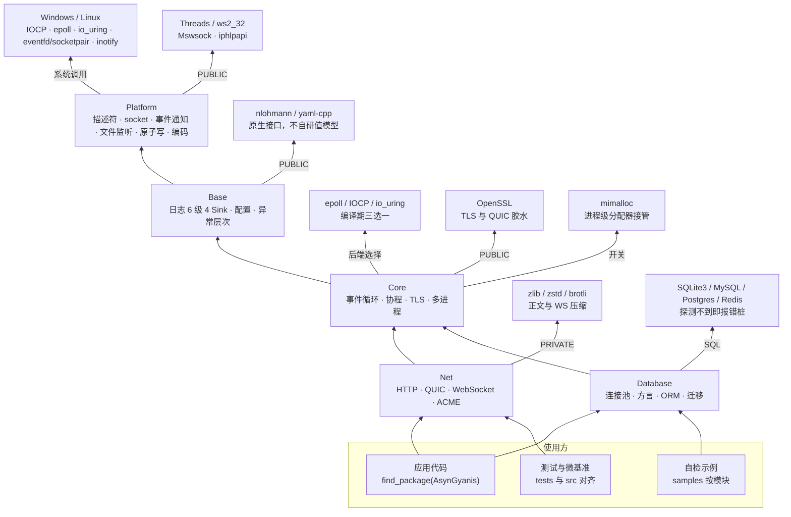

# AsynGyanis

> AsynGyanis 是面向 Linux 与 Windows 的 C++23 异步服务器引擎：协程运行时、网络协议栈与数据访问组件共用一套事件循环与生命周期契约。

[](https://en.cppreference.com/w/cpp/23)
[](https://kernel.org)
[](https://microsoft.com/windows)
[](LICENSE)
[](https://github.com/Gyanis9/AsynGyanis/actions/workflows/linux-ci.yml)
[](https://github.com/Gyanis9/AsynGyanis/actions/workflows/windows-ci.yml)

## 目录

- [为什么是 AsynGyanis](#为什么是-asyngyanis)
- [核心特性](#核心特性)
- [架构](#架构)
- [能力矩阵](#能力矩阵)
- [快速开始](#快速开始)
- [最小示例](#最小示例)
- [交付形态](#交付形态)
- [项目结构](#项目结构)
- [文档索引](#文档索引)
- [示例矩阵](#示例矩阵)
- [测试与验证](#测试与验证)
- [参与项目](#参与项目)
- [许可](#许可)

## 为什么是 AsynGyanis

- 引擎不绑业务：库里交付的是事件循环、协程运行时、协议栈与数据访问原语；路由表、表结构与部署形态都站在使用方那一侧，`ReferenceServer` 与按模块拆开的自检程序不在库的链接面上。
- 协程帧的生命周期是契约而不是实现细节：`start()` 这类常驻协程必须由调用方持有到收口，投递句柄后离开作用域会让协程帧被销毁——库里所有常驻协程同这一条规矩，见「最小示例」与 [架构设计](docs/架构设计.md)。
- 协议栈有外部裁判：h2、WebSocket、QUIC 与 HTTP/3 的验收拿另一份源代码的实现当对端（h2spec、Autobahn、aioquic、Pebble），自研实现不与自己的测试互测，见 [测试与验证](#测试与验证)。
- 质量门是仓库自己的代码：格式、复杂度冻结线、公开接口基线、正文引用追溯、台账日期、依赖同解、版本一致都是 `scripts/` 里可执行的判据，本地几秒到一两分钟跑得完，名单钉在 scripts/run-gates.sh:69 的 `GATE_NAMES`。

## 核心特性

| 领域 | 能力 |
| --- | --- |
| 异步运行时 | 每线程一个事件循环（Linux epoll、Windows 完成端口、Linux 可选 io_uring），三后端共用水平触发契约；`Task<T>` 惰性协程、两级就绪队列、`std::stop_token` 协作式取消、阻塞工作经 `AsyncExecutor` 挪出循环线程再投回指定循环 |
| 网络协议栈 | HTTP/1.1、HTTP/2、HTTP/3 与自研 QUIC 传输层（丢包恢复、可插拔拥塞控制、ECN、1-RTT 密钥更新）、WebSocket（含 permessage-deflate 与主题扇出）、TLS/mTLS 与证书热轮换、带连接池与 h2 多路复用的出站 HTTP 客户端（代理、重定向、按幂等性决定是否重试） |
| 数据访问 | 声明式 ORM、SQL 方言层、参数化执行、LIFO 连接池、RAII 事务与保存点、把行留在服务端的流式结果集；SQLite / MySQL / PostgreSQL / Redis 四驱动，可选依赖缺失时退化为报错桩 |
| 配置与可观测性 | YAML/JSON 多文件装载与热重载、严格类型化取值（宁可回落也不静默变形）；结构化日志、Prometheus 文本端点、进程级指标注册表（库内通道构造即登记）、OTLP/HTTP 指标与日志推送、链路追踪 |
| 安全与部署 | ACME（RFC 8555）证书自动签发与续期，支持 HTTP-01 与 DNS-01；安全响应头、Basic/Bearer 认证中间件、解析与并发限额、按来源限额与在途正文内存预算；多进程 worker 与崩溃补位、systemd 就绪上报与看门狗、SIGHUP 重载、POSIX 零停机换代 |
| 跨平台与交付 | 只支持 Linux 与 Windows；五个模块各自成库，可静态或共享，CMake 包配置支持按组件消费并自动带出传递依赖；Conan 2 是唯一维护的包路线 |

## 架构



证据：src/Platform/CMakeLists.txt:12、src/Platform/CMakeLists.txt:6-8、src/Platform/CMakeLists.txt:21、src/Platform/CMakeLists.txt:28-32、src/Platform/CMakeLists.txt:40、src/Platform/IO/Epoll.h:37、src/Platform/IO/Epoll.h:55、src/Platform/IO/Epoll.h:68、src/Base/CMakeLists.txt:17、src/Base/CMakeLists.txt:10-13、src/Base/CMakeLists.txt:64-68、src/Core/CMakeLists.txt:21、src/Core/CMakeLists.txt:27、src/Core/CMakeLists.txt:30、src/Core/CMakeLists.txt:34、src/Net/CMakeLists.txt:24、src/Net/CMakeLists.txt:41、src/Net/CMakeLists.txt:46、src/Net/CMakeLists.txt:52、src/Net/CMakeLists.txt:14-15、src/Database/CMakeLists.txt:54、src/Database/CMakeLists.txt:43-50、src/Database/CMakeLists.txt:5、src/Database/CMakeLists.txt:18、src/Database/CMakeLists.txt:27、src/Database/CMakeLists.txt:78、cmake/AsynGyanisOptions.cmake:8、cmake/AsynGyanisOptions.cmake:11、cmake/AsynGyanisOptions.cmake:12、cmake/AsynGyanisOptions.cmake:13、packaging/conan/test_package/CMakeLists.txt:8、CMakeLists.txt:68、CMakeLists.txt:20-25

要点：

- 静态是默认形态；BUILD_SHARED_LIBS 一开五个模块同转 SHARED（cmake/AsynGyanisOptions.cmake:16、cmake/AsynGyanisLibrary.cmake:7），符号可见性由单份 src/AsynGyanisExport.h 标注，共享形态另有 CI 作业（.github/workflows/windows-ci.yml:131-132）
- 只支持 Linux 与 Windows：其他系统在配置阶段 FATAL_ERROR（CMakeLists.txt:20-25），事件后端没有 kqueue
- add_subdirectory(src) 恒开（CMakeLists.txt:66）；tests 与 benchmarks/microbench 同挂 ASYN_BUILD_TESTS（cmake/AsynGyanisOptions.cmake:11、CMakeLists.txt:68-71），samples 挂 ASYN_BUILD_SAMPLES（cmake/AsynGyanisOptions.cmake:12、CMakeLists.txt:73-75）
- 关掉这两个开发者开关，库本身与安装规则完全不受影响：包配置由 ASYN_ENABLE_INSTALL 生成（cmake/AsynGyanisOptions.cmake:13、CMakeLists.txt:78）
- Epoll.h 用别名选后端：Windows 是 using Epoll = Iocp（src/Platform/IO/Epoll.h:37），开 ASYN_WITH_IO_URING 是 using Epoll = Uring（src/Platform/IO/Epoll.h:55），其余落到 POSIX epoll 实现（src/Platform/IO/Epoll.h:68）；成员集合一致故 EventLoop/IoWatcher 没有平台分支
- AcceptEx 接进来的连接只能由 IOCP 的 takeAcceptedSocket() 取走（src/Platform/IO/Iocp.h:126）；epoll 侧的同名成员只是返回 false 的占位（src/Platform/IO/Epoll.h:166），成员集合照旧对齐
- io_uring 只改后端选择，默认关且需要内核 5.6+（cmake/AsynGyanisOptions.cmake:9），Windows 上开它在配置阶段 FATAL_ERROR（cmake/AsynGyanisOptions.cmake:24）
- Net PUBLIC 链 Core 与 OpenSSL（src/Net/CMakeLists.txt:41-43、src/Net/CMakeLists.txt:52）：Platform 与 Base 由 Core 传递而来，而 TLS/QUIC 的公开头直接带着 OpenSSL 类型，使用方必须同样找得到它
- Database 既然直接用了 Base 的类型就自己声明，不靠 Core 传递（src/Database/CMakeLists.txt:68-73）
- 压缩库 PRIVATE 够用，但静态库以 LINK_ONLY 传给最终可执行体，包导出清单仍要登记 ZLIB/zstd/brotli（src/Net/CMakeLists.txt:46、src/Net/CMakeLists.txt:38）
- QUIC 与 HTTP/3 全为自研，Net 不链任何第三方 QUIC/h3（src/Net/CMakeLists.txt:14-15），跨实现验收走进程外裁判（scripts/quic_cross_check.sh:96）
- mimalloc 默认开（cmake/AsynGyanisOptions.cmake:8），接管是进程级的（src/Core/CMakeLists.txt:39）；它与 sanitizer 互斥，同开在配置阶段 FATAL_ERROR（cmake/AsynGyanisOptions.cmake:18）

依赖方向固定为 `Platform ← Base ← Core ← Net / Database`：下层不点名上层。

| 模块 | 库 | 职责 |
| --- | --- | --- |
| `Platform` | `AsynGyanis::Platform` | 描述符、套接字、事件通知、定时器、文件监听、原子写、编码转换、进程与时间、CPU 亲和与并行度测算、服务状态通知 |
| `Base` | `AsynGyanis::Base` | 日志、配置、异常层次、JSON/YAML 原生接口的传递依赖 |
| `Core` | `AsynGyanis::Core` | 事件循环、协程运行时、异步 socket、TLS、多进程编排 |
| `Net` | `AsynGyanis::Net` | TCP/UDP、HTTP/1.1/2/3、QUIC、WebSocket、路由与中间件、ACME、遥测出口 |
| `Database` | `AsynGyanis::Database` | 连接抽象、连接池、SQL 方言、ORM、建表迁移 |

Net 与 Database 是并列的上层模块，共用 Core 的循环与执行器。命名空间到模块名为止，include 路径从 `src/` 起算（`#include "Core/EventLoop/EventLoop.h"`）。事件循环、调度归属、协程帧与停止顺序见 [架构设计](docs/架构设计.md)。

## 能力矩阵

| 模块 | 后端与协议 |
| --- | --- |
| `Platform` | 描述符与套接字、事件通知、定时器、文件监听、原子写、编码转换；唤醒用 eventfd 与 socketpair，文件监听用 inotify，Windows 侧靠 ws2_32、Mswsock 与 iphlpapi |
| `Base` | 不做后端选择：日志、配置与异常层次，JSON 与 YAML 直接用 nlohmann 与 yaml-cpp 的原生接口，不自研值模型 |
| `Core` | epoll、IOCP、io_uring 三后端编译期三选一，共用水平触发契约；协程运行时与调度、TLS（OpenSSL）、多进程编排，可选进程级 mimalloc 接管 |
| `Net` | HTTP/1.1、HTTP/2、HTTP/3 与自研 QUIC 传输层、WebSocket（含 permessage-deflate）、TLS/mTLS 与证书热轮换、ACME、遥测出口；压缩用 zlib、zstd 与 brotli，全部 PRIVATE |
| `Database` | SQLite 必选，MySQL、PostgreSQL、Redis 三个可选驱动：探测不到即退化为报错桩；SQL 方言层、参数化执行、LIFO 连接池、ORM 与建表迁移 |

## 快速开始

### 前置条件

需要 CMake（使用仓库预设需 ≥ 3.25）、Ninja、Conan 2、Python，以及 MSVC ≥ 19.40 / GCC ≥ 13 / Clang ≥ 17。只支持 Linux 与 Windows：其他系统在配置阶段就报错。完整依赖与环境要求见 [入门与构建](docs/入门与构建.md)。

### 构建

Linux：

```bash
python3 -m pip install "conan>=2"
conan profile detect
cmake --preset debug
cmake --build --preset debug --parallel
ctest --preset debug
```

Windows 在已加载 `vcvars64` 的终端执行同样的三条 CMake 命令（以 `python -m pip install "conan>=2"` 起头）。第三方依赖在配置阶段自动安装，不需要手工执行 `conan install`。

### 起服务验一次 200

```bash
./build/debug/samples/ReferenceServer --port 8080 --threads 4 &
curl -i http://127.0.0.1:8080/
kill %1
```

`GET /` 回 200。其余参数打 `--help`；配置驱动、HTTPS/HTTP-3、多进程与证书自动化的起法见 [部署与运维](docs/部署与运维.md)。

## 最小示例

```cpp
#include "Core/Coroutine/ThreadPool.h"
#include "Core/EventLoop/IoContext.h"
#include "Core/Process/GracefulShutdown.h"
#include "Core/Socket/InetAddress.h"
#include "Net/Http/Server/HttpServer.h"
#include "Net/Http/Routing/Router.h"

#include <cstddef>
#include <memory>
#include <vector>

using namespace AsynGyanis;

int main()
{
    Core::IoContext context(2);
    const auto      address = Core::InetAddress::resolve("127.0.0.1", 8080);

    std::vector<std::unique_ptr<Net::HttpServer>> servers;
    std::vector<Core::Task<>>                     accepts;
    for (std::size_t index = 0; index < context.threadPool().threadCount(); ++index)
    {
        auto server = std::make_unique<Net::HttpServer>(context.threadPool().eventLoop(index), *address);
        server->router().get("/", [](Net::HttpRequest &, Net::HttpResponse &response) -> Core::Task<void> {
            response.setStatus(200);
            response.setHeader("Content-Type", "text/plain");
            response.setBody("Hello, AsynGyanis");
            co_return;
        });
        accepts.push_back(server->start());
        servers.push_back(std::move(server));
    }
    for (std::size_t index = 0; index < accepts.size(); ++index)
    {
        context.threadPool().eventLoop(index).scheduler().schedule(accepts[index].handle());
    }

    static_cast<void>(Core::GracefulShutdown::blockStopSignals());
    Core::GracefulShutdown shutdown;
    shutdown.onShutdown([&context] { context.stop(); });
    context.run();
    return 0;
}
```

`start()` 返回的协程必须被持有到服务器收口：投递句柄后立刻离开作用域会让协程帧被销毁。这条生命周期契约适用于库里所有常驻协程，见 [架构设计](docs/架构设计.md)。

## 交付形态

作为依赖消费：

```cmake
find_package(AsynGyanis REQUIRED COMPONENTS Net)
target_link_libraries(app PRIVATE AsynGyanis::Net)
```

只请求 `Net` 会自动带出 `Core`、`Base`、`Platform` 及其外部依赖；只请求 `Base` 不会去找 OpenSSL。安装、ABI 边界与 Conan 包见 [入门与构建](docs/入门与构建.md)。

第三方默认由 Conan 在配置期自动安装，可选客户端库另有开关（如库配方的 `with_mysql`，packaging/conan/conanfile.py:60）。开发侧的依赖图读 conandata.yml:1 的 `requirements`（conanfile.py:29）；库配方另列一份并补上 PUBLIC 依赖的传递形状（packaging/conan/conanfile.py:21），两份靠「依赖同解」机检钉在一起。Conan 2 是唯一维护的包路线；包消费方还有一条冒烟用例，只写 find_package 就链齐全部传递依赖（packaging/conan/test_package/CMakeLists.txt:8）。

## 项目结构

```text
CMakeLists.txt            版本唯一真源与目标平台门
CMakePresets.json         debug 与 release 构建预设
conanfile.py              本机开发与 CI 的依赖图入口
conandata.yml             第三方依赖版本清单
cmake/                    构建开关与互斥校验、库地基、sanitizer 与目标标志、安装与包配置、能力清单模板
src/                      Platform、Base、Core、Net、Database 五模块，include 从 src/ 起算
tests/                    与 src 同名分目录的用例，另有 TestSupport、Tools 与 acceptance 夹具
samples/                  按模块的自检示例与 ReferenceServer 部署形态
benchmarks/microbench/    热路径微基准，与基线文件同处 benchmarks/
scripts/                  门禁与验收脚本，run-gates.sh 是名单
packaging/conan/          Conan 2 配方与 test_package 消费方冒烟
docs/                     八份专题文档、文档导航与 RFC 规范留存
.github/workflows/        Linux 与 Windows 门禁、发布门与供应链作业
```

## 文档索引

| 你要做什么 | 看哪里 |
| --- | --- |
| 装工具链、构建、跑测试、以包形式消费 | [入门与构建](docs/入门与构建.md) |
| 理解循环、协程生命周期与模块边界 | [架构设计](docs/架构设计.md) |
| 写 HTTP/2/3、WebSocket、QUIC、出站客户端 | [网络编程](docs/网络编程.md) |
| 定义表结构、事务、连接池与流式结果 | [数据库访问](docs/数据库访问.md) |
| 起服务、多进程、停机换代、TLS 与证书自动化 | [部署与运维](docs/部署与运维.md) |
| 配置装载与限额、日志、指标、追踪、端点鉴权 | [配置与可观测性](docs/配置与可观测性.md) |
| 复跑门禁、示例矩阵、模糊测试、跨实现验收 | [测试与验证](docs/测试与验证.md) |
| 测吞吐与延迟、比对基线、评估构建选项 | [性能测试](docs/性能测试.md) |

更多入口：[文档导航](docs/文档导航.md)、[协议规范留存说明](docs/RFC/规范说明.md)、[贡献指南](CONTRIBUTING.md)、[安全政策](.github/SECURITY.md)、[更新日志](CHANGELOG.md)。

## 示例矩阵

`ReferenceServer` 是部署形态；能力另按模块拆成各自自检的程序，逐步打印 `✓`/`✗` 并留一行机器可读结论：

```bash
python scripts/run_samples.py --list                        # 现枚举清单与步数
python scripts/run_samples.py                               # 全部跑一遍
python scripts/run_samples.py --only NetHttpDemo --repeat 3 # 重复跑，抓靠时序侥幸的用例
```

源码在 `samples/` 下按模块分目录（`samples/Net/Http.cpp`、`samples/Database/OrmAndPool.cpp`、`samples/Core/Upgrade.cpp` 等），与 [网络编程](docs/网络编程.md)、[数据库访问](docs/数据库访问.md)、[部署与运维](docs/部署与运维.md) 的章节对应。

## 测试与验证

- `ctest --preset debug` 跑全量用例；Debug 档在 AddressSanitizer 下运行，零编译器告警是提交判据。
- 仓库级门禁（格式、复杂度冻结线、公开接口基线、正文引用追溯、台账日期、依赖同解、版本一致）都能在本地几秒到一两分钟内跑完，清单见 [测试与验证](docs/测试与验证.md)。
- 持续验证覆盖 Linux 与 Windows 两侧构建与用例、ThreadSanitizer、覆盖率（仅 Linux 能编到的部分）、按目标分档的持续模糊，以及拿不同源代码的实现当裁判的跨实现验收（h2spec、Autobahn、aioquic、Pebble）。
- 依赖真实服务端与机构的用例一律环境变量门控，没有凭据的机器上仍然全绿。

用例条数、覆盖率百分比与模糊执行总数以**当次运行**的作业摘要为准，本文件不抄历史数字。

## 参与项目

改动前请读 [贡献指南](CONTRIBUTING.md)：代码风格、注释与报错文案口径、提交信息规范、依赖变更要走的那四处。发现安全问题请按 [安全政策](.github/SECURITY.md) 私密报告，不要开公开 issue。

版本号遵循语义化版本，唯一真源是根 `CMakeLists.txt` 的 `project(AsynGyanis VERSION ...)`；发布节奏与每个已发布版本的变化见 [更新日志](CHANGELOG.md)。

## 许可

MIT，见 [LICENSE](LICENSE)。
