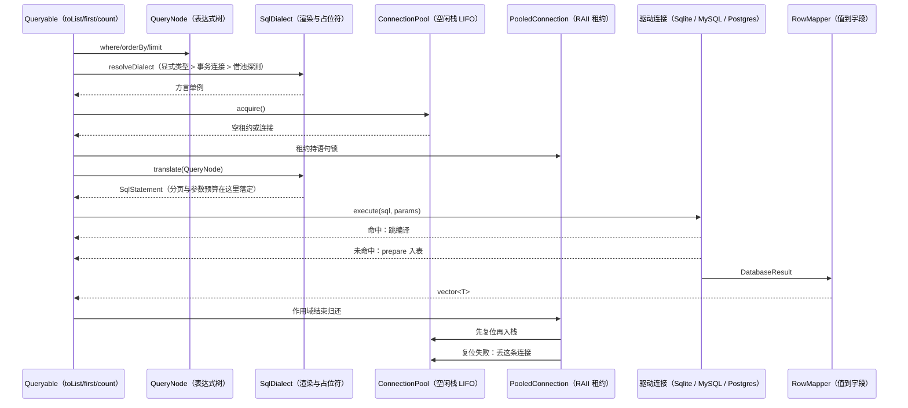

# 数据库访问

[返回文档导航](文档导航.md)

本文覆盖驱动、类型映射、ORM、连接池、事务与异步链路。可运行的完整用法见 [samples/Database/OrmAndPool.cpp](../samples/Database/OrmAndPool.cpp)。

## 模块结构



证据：src/Database/Queryable/Queryable.h:470、src/Database/Queryable/Queryable.h:491、src/Database/Queryable/Expression.h:157、src/Database/Queryable/QueryNode.h:118、src/Database/Dialect/StandardSqlDialect.cpp:457、src/Database/Dialect/SqliteDialect.cpp:16、src/Database/Dialect/DialectRegistry.cpp:12、src/Database/Queryable/QueryableImpl.h:499、src/Database/Pool/ConnectionPool.cpp:190、src/Database/Pool/ConnectionPool.cpp:217、src/Database/Pool/PoolConfig.h:43、src/Database/Queryable/Queryable.h:1445、src/Database/Pool/PooledConnection.cpp:158、src/Database/Sqlite/SqliteConnection.cpp:429、src/Database/MySql/MySqlConnection.cpp:655、src/Database/Postgres/PostgresConnection.cpp:781、src/Database/Queryable/RowMapper.h:855、src/Database/Queryable/RowMapper.h:397

要点：

- 参数上限按方言实际产出的占位符数判（src/Database/Dialect/StandardSqlDialect.cpp:428-430）：SQLite 999（src/Database/Dialect/SqliteDialect.h:161）、MySQL 65535（src/Database/Dialect/MySqlDialect.h:216）；批量写取 rowsPerStatement = 上限 / 列数（src/Database/Queryable/QueryableImpl.h:1104），分块必须同连接同事务（src/Database/Queryable/Queryable.h:1736）
- IS NULL、列-列比较不占参数；IN 展开才按元素个数计（src/Database/Dialect/StandardSqlDialect.cpp:169、171、176、179）
- 分页钩子在渲染里落：SQLite 内联十进制并补 LIMIT -1（src/Database/Dialect/SqliteDialect.cpp:27、36），MySQL 用 ?（src/Database/Dialect/StandardSqlDialect.cpp:437、443）
- 缓存键是 SQL 全文，容量 64 条按 LRU 逐出（src/Database/Sqlite/SqliteConnection.h:481、src/Database/MySql/MySqlConnection.h:538）
- SQLite 命中刷 stamp 并整趟跳过编译与边界探测；行没跑完先 detachCachedStatement，超 256 行快照界退回游标即不回缓存
- MySQL 任何失败一律 discardCachedStatement，刻意不做重编重试——写语句重试就是二次写入
- 一个驱动句柄就是一条协议流且非线程安全：BEGIN 在 A 线程、写在 B 线程会变成自动提交 + 回滚空事务，所以租约持语句锁（src/Database/Queryable/QueryableImpl.h:561、src/Database/Pool/Transaction.cpp:189 的 acquireStatementLock）
- commit 失败保留活跃标志让析构补 ROLLBACK；rollback 失败先 disconnect，脏会话绝不回池；丢弃判定只在池的归还路径里做一遍，故三条驱动同一处置（src/Database/Pool/Transaction.cpp:150、120、171；src/Database/Pool/ConnectionPool.cpp:745）
- 池耗尽返回空 PooledConnection 而不是抛，抛点在调用方；PoolConfig 有五个 0，含义各写各的：idleTimeout 0=不因空闲驱逐、maximumLifetime 0=一归还就过期、maximumPoolSize 0=一条都不许建、acquireTimeout 0=不排队直接拿空、maximumWaitingRequests 0=同样不排队（src/Database/Pool/PoolConfig.h:29-39）
- argv 组装走内联 8 槽的 ArgumentViewTable → redisCommandArgv；管道是 redisAppendCommandArgv + flushPipeline（src/Database/Redis/RedisConnection.cpp:247、1240、760、796）
- 归还前必须 resetSessionState：残留管道会被下一个借用者的 flush 代发、MULTI/WATCH 留在服务端侧本地清不掉、库位不还回就把键写进别人的库（src/Database/Redis/RedisConnection.cpp:1556、1560、1592、1597、1603）
- 订阅模式首条回复是命令回复，循环从 index 1 起只补收 targets-1 条（src/Database/Redis/RedisSubscription.cpp:195）；发布/订阅与命令共用同一个池，但订阅连接不可归还
- 可选依赖缺失时是报错桩：九个入口写「缺少 hiredis」（src/Database/Redis/RedisConnection.cpp:1287-1352、1550），isConnected 恒 false（src/Database/Redis/RedisConnection.cpp:1304），RedisResult 给 0 列与 monostate（src/Database/Redis/RedisResult.cpp:293、306）

| 目录 | 内容 |
| --- | --- |
| `Common/` | `DatabaseConnection` / `DatabaseResult` / `DatabaseValue` 抽象、`ConnectionConfig`、`DatabaseType`、`DatabaseFactory` |
| `Dialect/` | `SqlDialect` 契约、`StandardSqlDialect`（共用渲染）、`SqliteDialect` / `MySqlDialect` / `PostgresDialect`、`SqlStatement`、`ColumnType`、`DialectRegistry` |
| `Pool/` | `PoolConfig`、`PooledConnection`（RAII 租约）、`ConnectionPool`、`Transaction` |
| `Queryable/` | `Column` / `TableSchema` / `QueryNode` / `Expression`、`Queryable<T>`、`RowMapper`、`SchemaMigrator` |
| `Sqlite/` `MySql/` `Postgres/` `Redis/` | 四种驱动实现 |

公开类型在 `AsynGyanis::Database` 与 `AsynGyanis::Database::Queryable`（`TableSchema`、`Column`、`Queryable<T>` 都在后者）。查询树渲染与参数收集只有一份实现（`StandardSqlDialect`），各驱动只覆写引擎知识；写语句与事务语句一律由方言生成，ORM 不含 SQL 拼接。

MySQL、PostgreSQL 与 Redis 是可选依赖：探测不到时对应驱动退化为「每个入口给一条中文错误」的报错桩，不提供替代数据库行为。选项与检查见 [入门与构建](入门与构建.md)。

## 表结构与 ORM

结构体声明即表结构，读写与建表迁移共用同一份 `TableSchema`：

```cpp
#include "Database/Pool/ConnectionPool.h"
#include "Database/Queryable/Column.h"
#include "Database/Queryable/Expression.h"
#include "Database/Queryable/Queryable.h"
#include "Database/Queryable/SchemaMigrator.h"
#include "Database/Queryable/TableSchema.h"

struct User
{
    std::int64_t               id;
    std::string                name;
    std::optional<std::string> note;   // optional 成员 ⇒ 该列可空
    std::int64_t               age;
};

template<>
struct AsynGyanis::Database::Queryable::TableSchema<User>
{
    static constexpr std::string_view kTableName = "users";
    static constexpr auto kColumns = std::tuple{
        Column(&User::id,   "id"),
        Column(&User::name, "name"),
        Column(&User::note, "note"),
        Column(&User::age,  "age"),
    };
    static constexpr std::string_view kPrimaryKey = "id";
};
```

操作接口：`insert` / `toList` / `first` / `count` / `update` / 删除 / 批量插入。

- **唯一键冲突**可指定跳过或覆盖（`Queryable::InsertConflict`），关键词由方言给。
- **乐观锁**：`TableSchema` 里声明 `kVersionColumn` 即启用——`update` 的 WHERE 带上版本、SET 里由服务端加一，命中 0 行抛 `OptimisticLockException` 并点名表、版本列、期望值与主键。
- **悲观锁**：查询加 `.forUpdate()`。MySQL / PostgreSQL 在分页之后追加 `FOR UPDATE`，锁随事务结束释放；SQLite 没有行级锁，这一档在渲染阶段就拒并点名引擎，不会把「要锁」静默做成「不锁」。
- **补列迁移**：`SchemaMigrator::addMissingColumns` 按结构体补上缺的列，现有列直接问引擎，重复调用幂等。
- **取值一律以绑定参数送出**，不拼进 SQL 文本；含引号、`--`、分号的文本只会被当作数据。

## 类型映射与物理列

| 语义 | 声明 | 契约 |
| --- | --- | --- |
| 可空 | `std::optional<T>` | 绑成 SQL NULL；空值不要用默认值占位 |
| 任意字节 | `std::vector<std::uint8_t>` | 三家落到各自的二进制类型（MySQL `LONGBLOB`、PostgreSQL `BYTEA`、SQLite BLOB 存储类），含 `0x00`；PostgreSQL 的 BYTEA 文本形态由绑定层自己编解码 |
| 精确小数 | `Database::Decimal` | 规范十进制文本，位宽不受 int64/double 限制，不做算术也不假装归一化 |
| 瞬时时间 | `Database::Timestamp` | 回答「哪一刻」，微秒精度，跟着会话时区被引擎改写 |
| 墙上时间 | `Database::LocalDateTime` | 库里那串数字就是它自己，不随时区变，微秒精度 |

物理列名按引擎分家：

- **时间**：MySQL 两档都是 `DATETIME(6)`（不用 `TIMESTAMP`——它按会话时区换算取值，上限还停在 2038-01-19）；PostgreSQL 的瞬时落 `TIMESTAMPTZ`、墙上落 `TIMESTAMP(6)`；SQLite 没有这两类，落 `TEXT` 换逐位保真，好处是 ISO-8601 文本的字典序就是时间序。
- **十进制**：MySQL 是 `DECIMAL(65,30)`（小数按列定义定标，写入 `0.1` 读回 `0.100000000000000000000000000000`）；PostgreSQL 是不带限定的 `NUMERIC`（随写入的标度存，`0.100` 读回还是 `0.100`）；SQLite 没有十进制类型，落 TEXT 换逐位保真，代价是那一列的比较与排序按字典序（`"9" > "10"`），要数值语义请存整数分。

读写两侧的错配按列的语义拒：墙上时间列里读出带偏移的正文不当「抹平时区」收下，而是点名原文报错——这类静默折损正是「同一时刻两台机器读出两个数」的来源。

**非有限的浮点取值（NaN、±Infinity）在绑定前就拒并点名列名**：它们落库之后是哪个数由引擎决定，而 `insert()` 会照样报成功。

## 连接池

LIFO 复用、惰性创建、双机制清理（空闲回收 + 上限保护）。`PooledConnection` 是 RAII 租约；借出的连接可以 `discard()` 主动丢弃（驱动侧报过错、事务半路失败那一类脏会话），名额照旧腾出来。

- **借出前的探针**（`PoolConfig::probeBeforeAcquire`，默认关）：MySQL 发 `mysql_ping`、Redis 发 `PING`、PostgreSQL 沿用 `PQstatus`，SQLite 是本地文件没有对面可问。打开它等于**每条被复用的连接多一次网络往返**，P99 会跟着动，因此对「服务端从不单方面断连」的部署是纯税。
- **建连重试**（`maximumConnectAttempts`，默认 1＝不重试）：只认 `isTransientConnectFailure()` 那张表（MySQL 2002/2003、PostgreSQL 08xxx 与 57P01/02/03、SQLite BUSY/LOCKED、Redis `ECONNREFUSED`/`EHOSTUNREACH`/`ETIMEDOUT`/`EAGAIN`/`EINTR` 一类网络错）。**MySQL 2006/2013 刻意不在表里**——那两条说的是「一条已经发出去的语句中途断了」，写可能早已在服务端生效，重放就是重复副作用。退避 5 毫秒起翻倍、单次封顶 100 毫秒，总时长不超过 `acquireTimeoutMilliseconds`。退避睡在借用者所在的线程上（没有异步建连通路），所以在事件循环线程里借连接又把次数配高，会把那条循环按住到退避结束。
- 两条读数在 `/metrics` 上、构造即登记：`asyn_db_pool_connection_probes_total`、`asyn_db_pool_connect_retries_total`，另有等待数、等待名额被拒、借出超时、最久在借起点、当下持有、已丢弃、会话没复位干净等一族；口径见 [配置与可观测性](配置与可观测性.md)。

## 事务

`Transaction` 是 RAII：析构未提交即自动回滚。

- **保存点**：同一笔事务内可回退的段由 `savepoint()` / `rollbackToSavepoint()` / `releaseSavepoint()` 给出，两个引擎都不吃嵌套 BEGIN，回退不结束事务。回退成功后 `isActive()` 仍为真——这是它能替代嵌套事务的前提。
- **只读事务**：`TransactionAccessMode::ReadOnly` 把这一笔钉成只读。MySQL / PostgreSQL 发 `START TRANSACTION READ ONLY`，其中的写语句由服务端拒；SQLite 没有这个形态，构造当场拒绝并点名引擎，不退化成一笔普通事务。
- **整笔时限**：`setTimeLimit()` 到点后语句与提交都被拒，而回滚与析构照常收尾。
- **回调式收口**：`pool.withTransaction(回调)` 把「开事务 → 跑 → 提交 / 回滚」收成一处——回调抛出即回滚且异常照常向外传；回调正常返回而提交失败则抛 `QueryExecutionException`，不会把「业务跑完了但没落库」报成成功。

事务对象与其连接按事件循环归属使用：不要在一条循环上创建的事务里从另一条线程并发发语句，语句由 `m_statementMutex` 串行落在同一条连接上（驱动连接不是线程安全的）。跨线程的取消与超时语义见 [架构设计](架构设计.md)。

## 流式结果

`DatabaseConnection::executeStreaming()` 把行留在服务端，每调用一次 `next()` 才取一行（MySQL 文本协议走 `mysql_use_result`）。读一千万行与读十行不再是同一个内存量级。

代价明写在契约里：结果集必须比连接短命；它消费完之前那条连接不再接受新命令；`rowCount()` 回 0 表示「未知」；不能重扫。没实现这条入口的驱动明确回「不支持」，不偷偷退化成整份预读。

## 异步链路

同名的 `toListAsync` / `firstAsync` / `countAsync` / `insertAsync` / `insertBatchAsync` / `updateAsync` / `executeNonQueryAsync` 接受一个 `Core::EventLoop&` 作为恢复目标，`co_await` 它们即可。阻塞调用经 `Core::AsyncExecutor` 挪出事件循环线程，完成后投回指定循环。

- 恢复目标循环必须比执行器与结果对象活得久；先停执行器、后拆循环。
- 执行器队满会抛 `ExecutorSaturatedException`——HTTP 侧把它降级成 503，直接调用方要自己处置（见 [网络编程](网络编程.md)）。

## Redis 的 RESP 协议版本

`ConnectionConfig::redisProtocol` 默认 `Resp2`；`Resp3` 在建连并认证之后发一条 `HELLO 3`。

- 打开 RESP3 改的是**回复形状**：正在按交替下标配对读 `HGETALL` 的代码会静默错位一格，`SMEMBERS` / `CONFIG GET` 同理。谈不成 RESP3 时建连当场失败，**不静默回落 RESP2**。
- 订阅那一族（`SUBSCRIBE` / `PSUBSCRIBE`，以及 MONITOR 之后的推送读取）在 RESP3 档下**发送之前即拒**并给出原因——服务端把这些确认与消息改成 `>` 推送，而本驱动按「一条命令一条回复」执行，硬发会等满读写超时。要用订阅就留在 `Resp2`。
- 现场确认没有 `/metrics` 读数可看：发 `CLIENT INFO` 看回复里 proto 那一项是不是 3，或直接读 `HELLO` 的回复。另有一条实测与文档不符：Redis 命令文档称 `SMISMEMBER` 在 RESP3 回布尔，本机 8.10.1 实测回的是整数 `:1` / `:0`，按文档写 `std::get<bool>` 会一律读到「没有值」（本仓发 `HELLO 3` 并读它回复的地方：src/Database/Redis/RedisConnection.cpp:1088；RESP3 的布尔在本驱动按整数取值的地方：src/Database/Redis/RedisResult.cpp:262、263）

## 真机测试

依赖真实服务端的用例一律环境变量门控，口令无默认值、缺失即整组 `GTEST_SKIP`（不是失败），因此没有服务端的机器上仍然全绿：

| 服务 | 环境变量 | 用例位置 |
| --- | --- | --- |
| MySQL | `ASYN_MYSQL_TEST_HOST/PORT/USER/PASSWORD/DATABASE` | `tests/Database/MySql/TestMySqlIntegration.cpp` |
| Redis | `ASYN_REDIS_TEST_HOST/PORT/USER/PASSWORD/DATABASE` | `tests/Database/Redis/TestRedisIntegration.cpp` |

口令只从 `ASYN_*_TEST_*` 环境变量进；仓库里出现的口令全是写死的假口令，没有一把能打开真服务。覆盖范围与 CI 侧的真机作业见 [测试与验证](测试与验证.md)。
