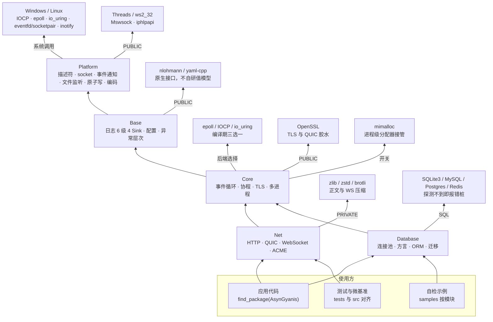
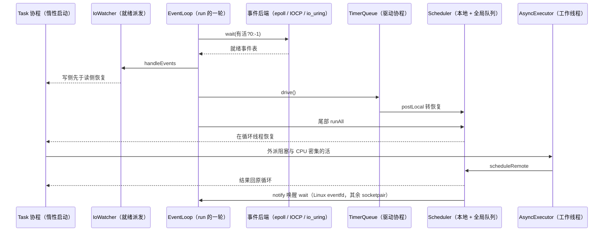

# 架构设计

[返回文档导航](文档导航.md)

AsynGyanis 以事件循环推进网络 I/O 和协程，将阻塞工作交给独立执行器。理解对象归属与停止顺序，比增加线程数更重要。

## 模块与依赖

| 模块 / CMake 目标 | 职责 | 主要依赖方向 |
| --- | --- | --- |
| `AsynGyanis::Platform` | 事件后端、描述符与套接字、文件、信号与管道、崩溃落场、进程与编码、CPU 亲和、服务通知 | 操作系统 |
| `AsynGyanis::Base` | 日志、配置、异常、JSON/YAML 接口 | Platform |
| `AsynGyanis::Core` | 事件循环、调度、协程、异步 socket、TLS、进程编排 | Base、Platform |
| `AsynGyanis::Net` | TCP/UDP、HTTP、WebSocket、QUIC、ACME、遥测出口 | Core 及下层 |
| `AsynGyanis::Database` | 驱动抽象、连接池、事务、方言与 ORM | Core、Base、Platform |

Net 与 Database 是并列的上层模块，数据库异步接口复用 Core 的执行器与恢复投递机制，不依赖 HTTP。组件安装与第三方依赖见 [入门与构建](入门与构建.md)。

头文件从 `src/` 下的相对路径包含，例如 `#include "Core/EventLoop/EventLoop.h"`。主要公开类型位于模块命名空间，但不能按目录机械推断：ORM 的 `TableSchema`、`Column` 和 `Queryable<T>` 实际位于 `AsynGyanis::Database::Queryable`；内部实现也有 `Detail` 命名空间。使用时以声明为准。

## 构建级依赖全图

这是构建级的全量依赖图：哪个模块链哪个、第三方库在哪接进来、三个事件后端从哪来。

证据：src/Platform/CMakeLists.txt:12、src/Platform/CMakeLists.txt:6-8、src/Platform/CMakeLists.txt:21、src/Platform/CMakeLists.txt:28-32、src/Platform/CMakeLists.txt:40、src/Platform/IO/Epoll.h:37、src/Platform/IO/Epoll.h:55、src/Platform/IO/Epoll.h:68、src/Base/CMakeLists.txt:17、src/Base/CMakeLists.txt:10-13、src/Base/CMakeLists.txt:64-68、src/Core/CMakeLists.txt:21、src/Core/CMakeLists.txt:27、src/Core/CMakeLists.txt:30、src/Core/CMakeLists.txt:34、src/Net/CMakeLists.txt:24、src/Net/CMakeLists.txt:41、src/Net/CMakeLists.txt:46、src/Net/CMakeLists.txt:52、src/Net/CMakeLists.txt:14-15、src/Database/CMakeLists.txt:54、src/Database/CMakeLists.txt:43-50、src/Database/CMakeLists.txt:5、src/Database/CMakeLists.txt:18、src/Database/CMakeLists.txt:27、src/Database/CMakeLists.txt:78、cmake/AsynGyanisOptions.cmake:8、cmake/AsynGyanisOptions.cmake:11、cmake/AsynGyanisOptions.cmake:12、cmake/AsynGyanisOptions.cmake:13、packaging/conan/test_package/CMakeLists.txt:8、CMakeLists.txt:68、CMakeLists.txt:20-25

要点：

- 只支持 Linux 与 Windows：其他系统在配置阶段 FATAL_ERROR（CMakeLists.txt:20-25），事件后端没有 kqueue
- add_subdirectory(src) 恒开（CMakeLists.txt:66）；tests 与 benchmarks/microbench 同挂 ASYN_BUILD_TESTS（cmake/AsynGyanisOptions.cmake:11、CMakeLists.txt:68-71），samples 挂 ASYN_BUILD_SAMPLES（cmake/AsynGyanisOptions.cmake:12、CMakeLists.txt:73-75）
- 关掉这两个开发者开关，库本身与安装规则完全不受影响：包配置由 ASYN_ENABLE_INSTALL 生成（cmake/AsynGyanisOptions.cmake:13、CMakeLists.txt:78）
- Epoll.h 用别名选后端：Windows 是 using Epoll = Iocp（src/Platform/IO/Epoll.h:37），开 ASYN_WITH_IO_URING 是 using Epoll = Uring（src/Platform/IO/Epoll.h:55），其余落到 POSIX epoll 实现（src/Platform/IO/Epoll.h:68）；成员集合一致故 EventLoop/IoWatcher 没有平台分支
- AcceptEx 接进来的连接只能由 IOCP 的 takeAcceptedSocket() 取走（src/Platform/IO/Iocp.h:126）；epoll 侧的同名成员只是返回 false 的占位（src/Platform/IO/Epoll.h:166），成员集合照旧对齐
- io_uring 只改后端选择，默认关且需要内核 5.6+（cmake/AsynGyanisOptions.cmake:9），Windows 上开它在配置阶段 FATAL_ERROR（cmake/AsynGyanisOptions.cmake:24）
- Net PUBLIC 链 Core 与 OpenSSL（src/Net/CMakeLists.txt:41-43、src/Net/CMakeLists.txt:52）：Platform 与 Base 由 Core 传递而来，而 TLS/QUIC 的公开头直接带着 OpenSSL 类型，使用方必须同样找得到它
- Database 既然直接用了 Base 的类型就自己声明，不靠 Core 传递（src/Database/CMakeLists.txt:68-73）
- 压缩库 PRIVATE 够用，但静态库以 LINK_ONLY 传给最终可执行体，包导出清单仍要登记 ZLIB/zstd/brotli（src/Net/CMakeLists.txt:46、src/Net/CMakeLists.txt:38）
- QUIC 与 HTTP/3 全为自研，Net 不链任何第三方 QUIC/h3（src/Net/CMakeLists.txt:48-49），跨实现验收走进程外裁判（scripts/quic_cross_check.sh:96）
- mimalloc 默认开（cmake/AsynGyanisOptions.cmake:8），接管是进程级的（src/Core/CMakeLists.txt:39）；它与 sanitizer 互斥，同开在配置阶段 FATAL_ERROR（cmake/AsynGyanisOptions.cmake:18）

## 事件循环与调度

证据：src/Core/Coroutine/Task.h:342、src/Core/EventLoop/IoWatcher.cpp:261、327、340、src/Core/EventLoop/EventLoop.cpp:169、src/Platform/IO/Epoll.cpp:85、src/Platform/IO/Iocp.cpp:844、src/Platform/IO/Uring.cpp:782、src/Core/EventLoop/TimerQueue.cpp:190、src/Core/Coroutine/Scheduler.cpp:190、src/Core/Coroutine/AsyncExecutor.h:321、src/Core/Coroutine/ThreadPool.cpp:99

要点：

- 先 runAll() 排空就绪（src/Core/EventLoop/EventLoop.cpp:207）→ 判 m_stopRequested（src/Core/EventLoop/EventLoop.cpp:209）→ 有活则超时取 0 否则 -1（src/Core/EventLoop/EventLoop.cpp:215）→ 进 WaitingForEvents 相位（src/Core/EventLoop/EventLoop.cpp:217）→ wait()（src/Core/EventLoop/EventLoop.cpp:221）
- 进 Working 相位（src/Core/EventLoop/EventLoop.cpp:227）→ 哨兵优先 drain（src/Core/EventLoop/EventLoop.cpp:261），否则判 isWatcherAlive（src/Core/EventLoop/EventLoop.cpp:278）再 handleEvents（src/Core/EventLoop/EventLoop.cpp:280）
- 定时器同一路唤醒驱动 TimerQueue::drive → 到期项走 postLocal；尾部再 runAll() 消费（src/Core/EventLoop/EventLoop.cpp:285）
- epoll 水平触发直接返回就绪表（src/Platform/IO/Epoll.cpp:99），没有重武装这一步
- IOCP 要重投探针模拟水平触发，另有待重投与待合成两张表（src/Platform/IO/Iocp.cpp:800-838）与 ConnectEx 投前先 bind 的专属通路（src/Platform/IO/Iocp.cpp:460、466）、takeAcceptedSocket 专属出口（src/Platform/IO/Iocp.cpp:405）
- io_uring 的一次性 POLL_ADD 要补投，且超时本身是一条 ring 操作（src/Platform/IO/Uring.cpp:742-818）；三后端稳态「每轮 wait() 0 分配」由同一条用例钉住（tests/Core/EventLoop/TestEventPoller.cpp:411）
- 没有工作窃取：全局队列里的条目必须回到它原来的循环执行（src/Core/Coroutine/Scheduler.h:31-35），负载均衡只发生在接受层
- Task 是惰性的：initial_suspend 立即挂起（src/Core/Coroutine/Task.h:342），启动点在 await_suspend 返回句柄那一刻，未启动的任务返回自身句柄就地启动（src/Core/Coroutine/Task.h:460），已启动的交回 noop 等终结点的对称转移（src/Core/Coroutine/Task.h:458）；协程帧内存走进程级 CoroutinePool（src/Core/Coroutine/Task.h:315）
- 停止是粘的：stop() 先置位再 wake（src/Core/EventLoop/EventLoop.cpp:294），run() 刻意不清 m_stopRequested（src/Core/EventLoop/EventLoop.cpp:171），一个 EventLoop 实例只有一回 run
- Cancelable 自己不 resume 任何东西：requestStop() 只把停止源置成已请求（src/Core/Coroutine/Cancelable.h:41），真打断靠 requestStop 加关闭套接字，由 ~IoWatcher 唤醒仍挂在等待器上的协程（src/Core/EventLoop/IoWatcher.cpp:227）

`IoContext` 持有 `ThreadPool`；每个工作线程绑定一个 `EventLoop` 与 `Scheduler`。网络连接在选定循环上创建和服务，负载分配发生在接受连接时，而不是在协程就绪队列间任意迁移。

事件循环围绕 I/O 就绪、定时器与待执行任务推进。Linux 默认 epoll，Windows IOCP 将完成通知转换为上层使用的事件位；Linux 可选 io_uring。上层采用水平触发及按需摘除关注位的契约，不能把三个后端的底层机制都理解为 epoll。

[EventBackendContract.h](../src/Core/EventLoop/EventBackendContract.h) 以 concept 检查描述符注册、修改、删除和等待接口。它验证可调用性与返回类型，不代替行为测试；Windows 与 io_uring 分支仍需各自构建和运行。

### 调度边界

[Scheduler](../src/Core/Coroutine/Scheduler.h) 包含本地队列与跨线程投递队列，不做工作窃取。

- 循环运行期间，`schedule()` / `postLocal()` 只能在所属线程调用；外来线程使用 `scheduleRemote()` / `postRemote()`。
- `runOne()`、`runAll()`、`hasWork()` 等不是通用线程安全读口。诊断应使用专门的原子快照，不跨线程遍历活动容器。
- 每趟 `runAll()` 最多处理 256 项，余项留到下一轮，避免持续投递挤占 I/O。
- 跨线程句柄与可调用体共用 65536 项积压上限。越界投递被拒并计数，不是无限缓冲队列；`scheduleRemote()` 不通过返回值承诺送达，应监测拒绝计数并处理过载根因。
- 回调异常在派发边界记录与计数，不向投递线程传播。队列中的普通可调用体若在循环退出前未执行，会被释放，捕获系统资源时应使用 RAII。

## 协程帧与取消

[Task<T>](../src/Core/Coroutine/Task.h) 惰性启动：创建任务不等于执行任务。`co_await` 驱动子任务，完成后通过对称转移恢复等待者；异常存入 promise，在读取结果时重抛。无人等待的异常另有日志出口。

**调度器不拥有协程帧。** `Task` 是帧的持有者，析构或移动赋值会销毁它。将 `task.handle()` 投递后，必须让 Task 活到最后一次恢复结束：

1. 先将 Task 收进生命周期足够长的容器，再排入调度器。
2. 不要在循环体的临时作用域中创建 accept Task、投递后立即离开作用域。
3. 协程 lambda 的闭包、引用捕获的对象及 `string_view` 指向的字节也必须跨越全部挂起点存活；持有帧不自动延长外部对象的生命。
4. 先让生产恢复动作的一方停止并完成投递，再拆目标循环；不能一边投递一边析构循环。

取消是协作式的。`std::stop_token` 表达停止请求，不会强制中断任意 C++ 函数。处理器需检查令牌、结束等待并返回；队列空、已发停止请求、协程真正结束，是三个不同状态。HTTP 的超时和对端取消边界见 [网络编程](网络编程.md)。

## 阻塞工作与恢复

[AsyncExecutor](../src/Core/Coroutine/AsyncExecutor.h) 用独立工作线程承载数据库驱动、文件 I/O 或大块计算。`submit(completionLoop, work)` 将结果或异常投回指定 EventLoop，不能在工作函数里直接操作该循环的 socket、TLS 会话或协程帧内可变对象。

工作函数的输入应按值捕获。执行器每个工作线程允许积压 256 项任务，队满通过 `ExecutorSaturatedException` 报告；停机拒绝不是同一种过载。HTTP 会将执行器饱和映射为 503，而业务逻辑异常仍是 500。

执行器析构会处理已接收任务并等待工作线程退出，因此要先析构执行器、后析构恢复目标循环。Task 仍需保留到恢复动作被处理完；工作线程已完成或 `pendingTaskCount()==0` 不代表句柄已经从目标调度队列消费完毕。

## 运行时启停与资源

- `IoContext::run()` 启动线程池并阻塞调用线程；也可显式 `threadPool().start()` 后由外部主线程管理等待。
- `IoContext::stop()` 与 `ThreadPool::stop()` 会等待工作线程，不能从本池工作线程调用，否则存在自 join；收尾交给池外线程。
- ThreadPool 支持停止后再启动，但会重建 EventLoop。旧的 `eventLoop(i)` / `scheduler(i)` 引用失效，依赖这些对象的服务也不能直接继续使用。
- 线程数为 0 时采用 `Platform::CpuAffinity::recommendedWorkerCount()`，综合硬件核数、许可 CPU 集合与 cgroup 配额。显式线程数不等于可用算力。
- `setThreadsPinnedToCores(true)` 必须在启动前设置。按许可核集合绑定，线程超出核数时余下线程可迁移；绑定失败记录 WARN，不阻止启动。
- `CoroutinePool` 为 Task 协程帧提供分配池；mimalloc 默认启用，是整个进程的分配器替换（sanitizer 档显式关闭），不只是协程池开关。

平台能力收在 Platform：事件后端、信号屏蔽与等待、匿名管道、崩溃落场、进程启停与套接字数据面都在 Platform 内消化 Win32/POSIX 差异；`WorkerSupervisor`、`GracefulShutdown`、`ReloadSignal` 只保留属主、派发与重启策略，不再出现平台条件分支。`check-platform-boundary.py` 把这条边界钉成棘轮：新增的 OS 头、系统调用或平台分支必须落在 Platform 内，否则门禁判红。

## 进程与观测边界

多 worker 由 `WorkerSupervisor` 拉起和看护，各进程不共享路由状态、连接池或指标注册表。POSIX 可独立 bind 同端口；Windows 需 master 绑定后移交 socket。运行示例的支持面小于库的支持面，具体见 [部署与运维](部署与运维.md)。

`ProcessMetricsRegistry::registerMetric()` 返回 RAII 注册句柄，析构即注销。模块对象可在构造时登记进程指标；HTTP 抓取与 OTLP 推送读取同一注册表，但不是跨进程汇总器。归属、聚合与诊断方法见 [配置与可观测性](配置与可观测性.md)。

## 源码阅读路径

| 目录 | 阅读重点 |
| --- | --- |
| `src/Platform/IO`、`FileSystem`、`System` | 系统资源持有与平台差异 |
| `src/Base/Config`、`Log`、`Exception` | 快照、日志通道与错误边界 |
| `src/Core/EventLoop`、`Coroutine` | 循环、定时器、调度、帧与执行器 |
| `src/Core/Socket`、`Tls`、`Crypto` | 异步传输、解析、TLS 与摘要/HMAC |
| `src/Core/Process`、`Metrics` | 启停、重载、看门狗、交接与进程读数 |
| `src/Net` | 协议与服务装配，见 [网络编程](网络编程.md) |
| `src/Database` | 方言、驱动与 ORM，见 [数据库访问](数据库访问.md) |
| `samples`、`tests` | 公开入口用法与契约测试 |
| `cmake`、`packaging/conan` | 导出、能力头与消费方构建 |
| `scripts`、`benchmarks` | 验证入口与性能测量 |

测试目录大体镜像源码；`tests/TestSupport` 提供循环夹具，`tests/Tools` 放进程外探针，`tests/Net/Fuzz` 放模糊目标。实现变更应同时核对生命周期测试与 [测试与验证](测试与验证.md) 中对应的平台验证面。
