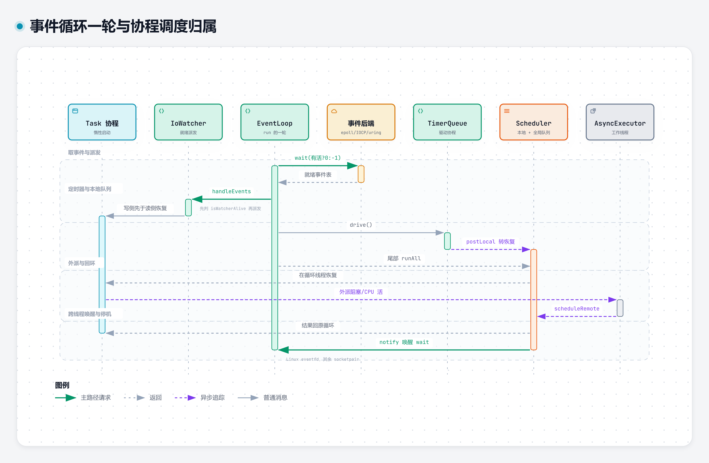

# 架构设计

[返回文档导航](文档导航.md)

AsynGyanis 以事件循环推进网络 I/O 和协程，将阻塞工作交给独立执行器。理解对象归属与停止顺序，比增加线程数更重要。

## 模块与依赖

| 模块 / CMake 目标 | 职责 | 主要依赖方向 |
| --- | --- | --- |
| `AsynGyanis::Platform` | 描述符、套接字、文件、进程、编码、CPU 亲和、服务通知 | 操作系统 |
| `AsynGyanis::Base` | 日志、配置、异常、JSON/YAML 接口 | Platform |
| `AsynGyanis::Core` | 事件循环、调度、协程、异步 socket、TLS、进程编排 | Base、Platform |
| `AsynGyanis::Net` | TCP/UDP、HTTP、WebSocket、QUIC、ACME、遥测出口 | Core 及下层 |
| `AsynGyanis::Database` | 驱动抽象、连接池、事务、方言与 ORM | Core、Base、Platform |

Net 与 Database 是并列的上层模块，数据库异步接口复用 Core 的执行器与恢复投递机制，不依赖 HTTP。组件安装与第三方依赖见 [入门与构建](入门与构建.md)。

头文件从 `src/` 下的相对路径包含，例如 `#include "Core/EventLoop/EventLoop.h"`。主要公开类型位于模块命名空间，但不能按目录机械推断：ORM 的 `TableSchema`、`Column` 和 `Queryable<T>` 实际位于 `AsynGyanis::Database::Queryable`；内部实现也有 `Detail` 命名空间。使用时以声明为准。

## 事件循环与调度

`IoContext` 持有 `ThreadPool`；每个工作线程绑定一个 `EventLoop` 与 `Scheduler`。网络连接在选定循环上创建和服务，负载分配发生在接受连接时，而不是在协程就绪队列间任意迁移。

事件循环围绕 I/O 就绪、定时器与待执行任务推进。Linux 默认 epoll，Windows IOCP 将完成通知转换为上层使用的事件位；Linux 可选 io_uring。上层采用水平触发及按需摘除关注位的契约，不能把三个后端的底层机制都理解为 epoll。

[EventBackendContract.h](../src/Core/EventLoop/EventBackendContract.h) 以 concept 检查描述符注册、修改、删除和等待接口。它验证可调用性与返回类型，不代替行为测试；Windows 与 io_uring 分支仍需各自构建和运行。

### 调度边界

[Scheduler](../src/Core/Coroutine/Scheduler.h) 包含本地队列与跨线程投递队列，不做工作窃取。

- 循环运行期间，`schedule()` / `postLocal()` 只能在所属线程调用；外来线程使用 `scheduleRemote()` / `postRemote()`。
- `runOne()`、`runAll()`、`hasWork()` 等不是通用线程安全读口。诊断应使用专门的原子快照，不跨线程遍历活动容器。
- 每趟 `runAll()` 最多处理 256 项，余项留到下一轮，避免持续投递挤占 I/O。
- 跨线程句柄与可调用体共用 65536 项积压上限。越界投递被拒并计数，不是无限缓冲队列；`scheduleRemote()` 不通过返回值承诺送达，应监测拒绝计数并处理过载根因。
- 回调异常在派发边界记录与计数，不向投递线程传播。队列中的普通可调用体若在循环退出前未执行，会被释放，捕获系统资源时应使用 RAII。

## 协程帧与取消

[Task<T>](../src/Core/Coroutine/Task.h) 惰性启动：创建任务不等于执行任务。`co_await` 驱动子任务，完成后通过对称转移恢复等待者；异常存入 promise，在读取结果时重抛。无人等待的异常另有日志出口。

**调度器不拥有协程帧。** `Task` 是帧的持有者，析构或移动赋值会销毁它。将 `task.handle()` 投递后，必须让 Task 活到最后一次恢复结束：

1. 先将 Task 收进生命周期足够长的容器，再排入调度器。
2. 不要在循环体的临时作用域中创建 accept Task、投递后立即离开作用域。
3. 协程 lambda 的闭包、引用捕获的对象及 `string_view` 指向的字节也必须跨越全部挂起点存活；持有帧不自动延长外部对象的生命。
4. 先让生产恢复动作的一方停止并完成投递，再拆目标循环；不能一边投递一边析构循环。

取消是协作式的。`std::stop_token` 表达停止请求，不会强制中断任意 C++ 函数。处理器需检查令牌、结束等待并返回；队列空、已发停止请求、协程真正结束，是三个不同状态。HTTP 的超时和对端取消边界见 [网络编程](网络编程.md)。

## 阻塞工作与恢复

[AsyncExecutor](../src/Core/Coroutine/AsyncExecutor.h) 用独立工作线程承载数据库驱动、文件 I/O 或大块计算。`submit(completionLoop, work)` 将结果或异常投回指定 EventLoop，不能在工作函数里直接操作该循环的 socket、TLS 会话或协程帧内可变对象。

工作函数的输入应按值捕获。执行器每个工作线程允许积压 256 项任务，队满通过 `ExecutorSaturatedException` 报告；停机拒绝不是同一种过载。HTTP 会将执行器饱和映射为 503，而业务逻辑异常仍是 500。

执行器析构会处理已接收任务并等待工作线程退出，因此要先析构执行器、后析构恢复目标循环。Task 仍需保留到恢复动作被处理完；工作线程已完成或 `pendingTaskCount()==0` 不代表句柄已经从目标调度队列消费完毕。

## 运行时启停与资源

- `IoContext::run()` 启动线程池并阻塞调用线程；也可显式 `threadPool().start()` 后由外部主线程管理等待。
- `IoContext::stop()` 与 `ThreadPool::stop()` 会等待工作线程，不能从本池工作线程调用，否则存在自 join；收尾交给池外线程。
- ThreadPool 支持停止后再启动，但会重建 EventLoop。旧的 `eventLoop(i)` / `scheduler(i)` 引用失效，依赖这些对象的服务也不能直接继续使用。
- 线程数为 0 时采用 `Platform::CpuAffinity::recommendedWorkerCount()`，综合硬件核数、许可 CPU 集合与 cgroup 配额。显式线程数不等于可用算力。
- `setThreadsPinnedToCores(true)` 必须在启动前设置。按许可核集合绑定，线程超出核数时余下线程可迁移；绑定失败记录 WARN，不阻止启动。
- `CoroutinePool` 为 Task 协程帧提供分配池；可选 mimalloc 是整个进程的分配器替换，不只是协程池开关。

平台能力通常收在 Platform。事件循环后端及 `WorkerSupervisor`、`GracefulShutdown`、`ReloadSignal` 等与循环/进程生命周期紧耦合的实现直接处理 Win32/POSIX，这些是明确的平台边界，不应据此假定任意上层代码都可跨平台。

## 进程与观测边界

多 worker 由 `WorkerSupervisor` 拉起和看护，各进程不共享路由状态、连接池或指标注册表。POSIX 可独立 bind 同端口；Windows 需 master 绑定后移交 socket。运行示例的支持面小于库的支持面，具体见 [部署与运维](部署与运维.md)。

`ProcessMetricsRegistry::registerMetric()` 返回 RAII 注册句柄，析构即注销。模块对象可在构造时登记进程指标；HTTP 抓取与 OTLP 推送读取同一注册表，但不是跨进程汇总器。归属、聚合与诊断方法见 [配置与可观测性](配置与可观测性.md)。

## 源码阅读路径

| 目录 | 阅读重点 |
| --- | --- |
| `src/Platform/IO`、`FileSystem`、`System` | 系统资源持有与平台差异 |
| `src/Base/Config`、`Log`、`Exception` | 快照、日志通道与错误边界 |
| `src/Core/EventLoop`、`Coroutine` | 循环、定时器、调度、帧与执行器 |
| `src/Core/Socket`、`Tls`、`Crypto` | 异步传输、解析、TLS 与摘要/HMAC |
| `src/Core/Process`、`Metrics` | 启停、重载、看门狗、交接与进程读数 |
| `src/Net` | 协议与服务装配，见 [网络编程](网络编程.md) |
| `src/Database` | 方言、驱动与 ORM，见 [数据库访问](数据库访问.md) |
| `samples`、`tests` | 公开入口用法与契约测试 |
| `cmake`、`packaging/conan` | 导出、能力头与消费方构建 |
| `scripts`、`benchmarks` | 验证入口与性能测量 |

测试目录大体镜像源码；`tests/TestSupport` 提供循环夹具，`tests/Tools` 放进程外探针，`tests/Net/Fuzz` 放模糊目标。实现变更应同时核对生命周期测试与 [测试与验证](测试与验证.md) 中对应的平台验证面。
