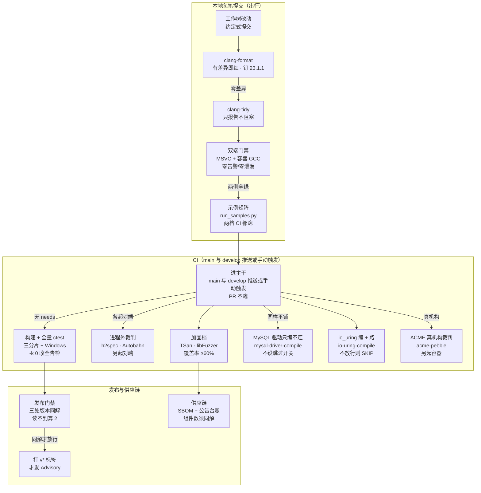

# 测试与验证

[返回文档导航](文档导航.md)

本文说明验证面由哪些部分组成、怎么在本地复跑、以及怎么读结果。性能测量单独在 [性能测试](性能测试.md)。



证据：CONTRIBUTING.md:87、CONTRIBUTING.md:61、CONTRIBUTING.md:63、cmake/AsynGyanisTargetFlags.cmake:6、cmake/AsynGyanisSanitizers.cmake:14、CMakePresets.json:10、scripts/run_samples.py:194、scripts/run_samples.py:229、.github/workflows/linux-ci.yml:20、.github/workflows/linux-ci.yml:106、.github/workflows/linux-ci.yml:236、.github/workflows/linux-ci.yml:300、.github/workflows/linux-ci.yml:323、.github/workflows/linux-ci.yml:330、.github/workflows/linux-ci.yml:358、.github/workflows/linux-ci.yml:374、.github/workflows/linux-ci.yml:404、.github/workflows/linux-ci.yml:440、.github/workflows/linux-ci.yml:641、.github/workflows/linux-ci.yml:808、.github/workflows/linux-ci.yml:995、.github/workflows/linux-ci.yml:1071、.github/workflows/linux-ci.yml:1137、.github/workflows/windows-ci.yml:91、scripts/check-coverage-gate.py:46、scripts/check-release-version.py:8、.github/workflows/release-gate.yml:17、.github/workflows/supply-chain.yml:12、scripts/check-dependency-advisories.py:71

要点：

- build-and-test：platform-base-core / net / database 三分片并行，fail-fast: false，一个红不掩盖其它（.github/workflows/linux-ci.yml:34-49）
- protocol-conformance：h2spec v2.6.0 明文（--strict）+ TLS 两轮、WS 互操作探针、Autobahn 判 behavior=FAILED 必须为 0
- http3-acceptance：h3_cross_check、quic_cross_check、quic_outbound_cross_check（Release 构建）
- thread-sanitizer 另起 build/tsan 只跑并发用例集；protocol-fuzz 每目标 90 秒（.github/workflows/linux-ci.yml:817-818 把 90 传给 scripts/fuzz-net.sh）且 -error_exitcode=1
- formatting 与 coverage 是硬失败，clang-tidy 只报告；mysql-driver-compile 只编不连（.github/workflows/linux-ci.yml:323），io-uring-compile 编 + 跑（.github/workflows/linux-ci.yml:374），acme-pebble 拉真机构镜像做跨实现验收（.github/workflows/linux-ci.yml:1071）
- 四条工作流的作业之间零 needs：全部平铺并行，串行只发生在作业内部（checkout → 配置 → 构建 → ctest）
- PR 不触发（免费分钟数有限，一次全量构建加用例几十个 runner 分钟）：要只验证某个提交就手动 dispatch；develop 自 2026-10-17 起也进 CI（.github/workflows/linux-ci.yml:18）
- 示例矩阵两档 CI 都跑（.github/workflows/linux-ci.yml:995 的 samples 作业、.github/workflows/windows-ci.yml:104 的示例矩阵步骤），本地与容器同样要跑；示例每条 check 都要能红
- 外部裁判要另起进程或容器：Autobahn 在另一网络命名空间经 host-gateway 回宿主，服务端须绑 0.0.0.0 另开端口
- 真机凭据走环境变量：ASYN_MYSQL_TEST_*、ASYN_REDIS_TEST_HOST/PASSWORD、ASYN_ACME_TEST_DIRECTORY_URL/_CONTACT_EMAIL/_ACCOUNT_STATE_DIR，缺任一即跳过
- 按能力门控：Windows 没有 SO_REUSEPORT 就跳过共享端口；内核挡 io_uring_setup 时打警告后退化为只编译
- Redis 在 build-and-test 的 database 分片真起，coverage 作业另起一台；会构建 Database 的作业里，除 mysql-driver-compile 与 coverage 外都设 ASYN_SKIP_MYSQL_DEPS=1 跳过 MySQL 依赖——mysql-driver-compile 刻意不设它，只编驱动不连真机，coverage 作业同样取真依赖并起真库跑用例
- 版本一致性判据是三处必须同解：CMake project VERSION、CHANGELOG 最新段、最新 v* 标签；不一致退 1，读不到退 2
- SBOM 出 CycloneDX 1.6 + SHA256SUMS，组件数与 conandata 条数不同解即红；公告台账钉「固定版本与台账同解」，--fetch 不可达只提示
- 修复走 develop，补丁进 main、打上 v* 标签后才发 Advisory：交的是依赖清单与来源，不是签名后的二进制

## 测试组织

- 框架是 GoogleTest，`gtest_discover_tests` 让**每个用例独立进程**——用例不靠别处初始化，也不共享进程内状态。
- `tests/` 逐级镜像 `src/`；`tests/TestSupport/` 放共用的循环与夹具，`tests/Tools/` 放进程外探针，`tests/Net/Fuzz/` 放模糊目标与属性化随机用例。
- 零编译器告警是提交判据（`-Wall -Wextra -Werror` / `/W4 /WX`）；Debug 档要在 AddressSanitizer 下跑通且无报告。

构建与跑测的入口见 [入门与构建](入门与构建.md)：

```bash
cmake --preset debug
cmake --build --preset debug --parallel
ctest --preset debug
```

## 仓库级门禁

这些判据不依赖构建产物，几秒钟到一两分钟就能跑完，提交前自己先过一遍，别把 CI 当第一次提示：

```bash
python scripts/check-complexity-baseline.py     # 函数体行数冻结线，只准降不准升
python scripts/check-arch-traceability.py       # 台账正文里的「路径:行号」引用是否还成立
python scripts/check-ledger-dates.py            # 台账里「提交号（日期）」与 git 作者日期是否同解
python scripts/check-api-baseline.py            # 公开接口面与 packaging/api-baseline.txt 同解
python scripts/check-module-layering.py         # include 与 CMake 依赖只允许单向分层
python scripts/check-platform-boundary.py       # Platform 之外不得出现系统头、OS API、平台分支
python scripts/check-duplicate-code.py          # 归一化重复窗口只准减少
python scripts/check-release-version.py         # CMake 版本号 / 更新日志最新段 / 最新标签三处同解
python scripts/check-dependency-advisories.py   # 依赖清单、公告台账、文档依赖表、交付配方四处同解
```

`scripts/run-gates.sh` 把格式检查（整树 `clang-format --dry-run -Werror`）、`GATE_NAMES` 点名的那些判据（注释预算、复杂度、正文引用追溯、台账日期、接口基线、分层、平台边界、重复代码）、一次预设构建 + `ctest` 与示例矩阵串成一条本地流水线，日志落在 `build/gate-logs/`。上面清单里的版本一致性与依赖同解不在其中：前者在 `release-gate` 工作流里跑（要标签与历史），后者在 `supply-chain` 工作流里跑。

三道架构门各有 `--write` 重录基线；重录必须在提交正文说明原因。`scripts/test-architecture-gates.py` 在 `build/gate/` 下造夹具，证明它们「种违规必红、撤掉必绿」。

**判据共同的下限**：提取数塌掉、清单为空、找不到工具、没重新 configure 一律退 **2**（这道门没跑成），与「跑过了但发现问题」的退 1 分开。看到红先读到「是哪一步、哪一条判据」，别把「拿不到裁判」读成「判据通过」，也别反过来把环境问题算成代码缺陷。

### 本地渲染 Mermaid（提交前目检）

`build/gate/check-mermaid.py` 只查首行图型、`subgraph`/`state` 配平与引号奇偶，读不出语法错误：`loop` 这类保留字出现在时序图里、复合态描述里写了 `Core::Timer` 这种双冒号，结构检查都判绿，到 GitHub 上是红框。新增或改过的图提交前渲染一次：

```bash
PUPPETEER_SKIP_DOWNLOAD=1 npx -y @mermaid-js/mermaid-cli@11 \
  -p build/gate/mmd/puppeteer.json -s 2 \
  -i build/gate/mmd/01.mmd -o build/gate/mmd/01.png
```

`puppeteer.json` 里的 `executablePath` 指向本机 Chrome，不另下浏览器；`-s 2` 是两倍缩放，`-i`/`-o` 换成要检的那块。退出码非 0 时 stderr 里是解析器的 `Parse error on line N` 与期望记号，照那两行改。

## 示例矩阵

自检程序既是用例也是「从库外驱动公开面」的证据：

```bash
python scripts/run_samples.py                              # 全部跑一遍
python scripts/run_samples.py --list                       # 现枚举清单与步数（新增程序不必改脚本）
python scripts/run_samples.py --only NetHttpDemo --repeat 3  # 重复跑，抓靠时序侥幸的用例
python scripts/run_samples.py --build build/release --timeout 300
```

每个程序逐步打印 `✓`/`✗`，并在 stdout 留一行 `RESULT <名字> PASS|FAIL <步数> gated <跳过数>`（退出码 0 表示全绿）。`<步数>` 只算真正执行过的步，`gated` 单列因环境不齐备（真机凭据缺席这类）而跳过的步——两者分开，「真机跑过」与「真机没跑」才不会给出同一条结论。

程序按模块分布：`BaseLog`、`BaseConfig`、`PlatformPrimitives`、`CoreLoop`、`CoreTls`、`CoreWorker`、`CoreUpgrade`、`NetHttpDemo`、`NetHttpsH2Demo`、`NetHttp3Demo`、`NetGateway`、`NetUdpDemo`、`DatabaseDemo`，另有部署形态 `ReferenceServer`。**`CoreUpgrade`（零停机换代）只在 POSIX 构建**——Windows 受完成端口的句柄级关联限制；`PlatformPrimitives` 与 `CoreWorker` 的步骤数也按平台分叉（`sendfile`、fork/exec、进程组终止等各自专属）。`NetGateway` 是入站 `HttpServer` 加出站 `HttpClient` 的反向代理形状，**刻意只留在 samples/**：引擎里还没有反向代理这一层，先有真实消费方再决定收不收入库，它同时是一份「缺什么」的实测清单。逐程序步数以 `--list` 当次输出为准，不在文档里抄死。

## 真机与外部服务

依赖真实服务端的用例一律**环境变量门控**：口令无默认值、缺失即整组 `GTEST_SKIP`（不是失败），因此没有服务端的机器上仍然全绿。

| 目标 | 环境变量 | 位置 |
| --- | --- | --- |
| MySQL | `ASYN_MYSQL_TEST_HOST/PORT/USER/PASSWORD/DATABASE` | `tests/Database/MySql/TestMySqlIntegration.cpp` |
| Redis | `ASYN_REDIS_TEST_HOST/PORT/USER/PASSWORD/DATABASE` | `tests/Database/Redis/TestRedisIntegration.cpp` |
| ACME 机构 | `ASYN_ACME_TEST_DIRECTORY_URL` / `ASYN_ACME_TEST_CONTACT_EMAIL` / `ASYN_ACME_TEST_ACCOUNT_STATE_DIR` | `tests/Net/Acme/TestAcmeLiveAuthority.cpp` |

ACME 那一条只走「取目录 + 建号 / 复用账户」，不签发证书（真签发要一台公网可达且解析到本机的域名，HTTP-01 那条路在回归环境给不了）。三条变量缺一不可，其中 `..._ACCOUNT_STATE_DIR` 是**账户材料的持久目录**：账户建在机构侧是有速率配额的公开动作，没有跨轮次持久的地方就把指针写进环境变量，一次回归多出一个真账户。填 staging 端点（`https://acme-staging-v02.api.letsencrypt.org/directory`）不计入生产配额。

真签发的证据在 `tests/Tools/AcmeIssuanceProbe`：DNS-01 档不需要入站通路，凭据走 `ASYN_ACME_DNS_ACCESS_KEY_ID` / `ASYN_ACME_DNS_ACCESS_KEY_SECRET`。

仓库里出现的口令全是写死的假口令，没有一把能打开真服务；真凭据只从 `ASYN_*_TEST_*` 与上面那两条环境变量进。

## 消毒器与线程契约

| 开关 | 覆盖 | 边界 |
| --- | --- | --- |
| `ENABLE_SANITIZERS`（debug 预设 ON） | MSVC `/fsanitize=address`；GCC/Clang 额外带 UBSan | 容器注解因与未插桩 GoogleTest 的 ABI 标记冲突而关闭，不能把这档当成包含所有容器注解检查的 ASan；ASan 会显著抬高每帧栈开销，写深递归用例要按这个预算 |
| `SANITIZE_THREADS` | TSan | 不能与 ASan 同开；MSVC 不支持 |
| `ASYN_ENABLE_COVERAGE` | gcov 风格插桩 | 只在 GCC/Clang 侧；MSVC 没有 gcov 兼容工具链 |

`ThreadSanitizer：线程契约` 那一档跑的是筛面（并发相关用例）再全量。`TransactionTest.StatementsOnOneTransactionWaitForTheConnection` 的 `m_isActive` 读写已走 `std::atomic_ref`，该族也已纳入 TSan 过滤集；是否仍有竞态报告以 CI 的 TSan 作业为准，本地 MSVC 不支持 TSan。复跑变绿不等于竞态已修，读数按那一轮作业取。

## 覆盖率

只在 Linux 侧量：

```bash
cmake --preset debug -DASYN_ENABLE_COVERAGE=ON     # 就地重配，会触发一次全量重建
cmake --build --preset debug --parallel
ctest --preset debug
python scripts/run_samples.py --build build/debug --timeout 300
pip install gcovr && gcovr --root . --filter 'src/' --print-summary
```

阈值判据在 `scripts/check-coverage-gate.py`（按模块给下限），CI 的覆盖率作业跑完会把**当轮实测**打进作业摘要。**Windows 侧没有覆盖率读数**：IOCP、wepoll、`ReadDirectoryChangesW`、`TransmitFile` 这些只在 Windows 编到的实现不在 Linux 那份报告里；Windows 那几条作业只保证用例通过。别把「Windows 全绿」读成「两边都有覆盖率读数」。

## 持续模糊

`scripts/fuzz-net.sh` 用 libFuzzer 按目标分档跑协议解码器与不可信输入入口（HTTP/1 请求与响应、WebSocket 帧、HTTP/2 帧、HTTP/3 帧、HPACK、QPACK、permessage-deflate、QUIC 报文头/帧序列/传输参数、JWT 紧凑序列、配置与回复的 JSON 入口、远端文本进日志前的折法）。**目标清单有两处真源**：内核枚举 `tests/Net/Fuzz/ProtocolFuzzKernel.h` 与脚本默认清单，`scripts/check-fuzz-report.py` 的 `--targets` 是第三处——加一档要三处一起改，否则 CI 按「账上出现而未列」判红。

```bash
bash scripts/fuzz-net.sh 60                                  # 每档各跑 60 秒
ASYN_FUZZ_TARGETS="ConfigValueText LogEscaping" bash scripts/fuzz-net.sh 120
python scripts/check-fuzz-report.py .fuzz/log                # 分目标读数：执行次数、本类调用、串到别类
```

- 产物不链项目库：LLVM 官方 Windows 包的 fuzzer 运行时按静态 CRT（/MT）编，而本仓 MSVC 构建一律 /MD，lld-link 会拒绝混链。因此脚本只编「模糊内核 + 各档解码器 + 它们的真实依赖闭包」这一组翻译单元，两侧清单同一份。
- Linux 侧要求 clang 19 以上（libstdc++ 的 `<expected>` 守卫要 `__cpp_concepts >= 202002L`），且不能换 libc++（fuzzer 运行时按 libstdc++ 编）。
- 违例样本落 `.fuzz/artifacts/`，把那份输入原样搬进 `tests/Net/Fuzz/TestProtocolFuzz.cpp` 的种子用例即可常驻。语料留 14 天是给「喂回本地继续挖」用的，不是增量缓存。
- 判据本身要能被证伪：新加一档先给一个已知畸形输入，断言它按预期报错而不是崩；再用突变法确认那几条不变量真的会红（`tests/Net/Fuzz/TestProtocolFuzz.cpp` 文件头记了已证过的清单）。

## 跨实现验收

对面换成**不同源代码的实现**，因为进程内的桩与实现同源、一起被改，两边错在同一种理解上时会一起绿：

| 作业 | 对面 | 脚本 |
| --- | --- | --- |
| 规范裁判：h2spec 与 Autobahn | h2spec（明文 `--strict` 与 TLS 两轮）、Autobahn WebSocket | `.github/workflows/linux-ci.yml` 内的对应步骤、`scripts/websocket_autobahn.sh`、`scripts/ws_interop_probe.py`、`scripts/h2_adversarial_probe.sh` |
| HTTP/3 跨实现验收 | aioquic（含取消探针） | `scripts/h3_acceptance.py`、`scripts/h3_cancellation_probe.py`、`scripts/quic_cross_check.py`、`scripts/fd_takeover_probe.py` |
| ACME 真机构验收 | Pebble（Let's Encrypt 官方测试服务端，Go 实现） | `scripts/acme_pebble_cross_check.sh` |

Pebble 那一档不需要公网机器：把镜像里的 `app` 与 `test/` 取到一处目录（`docker create ghcr.io/letsencrypt/pebble:latest` 再 `docker export` 解包），脚本用自己的端口现造一份配置起对面，域名用 `127.0.0.1.sslip.io` 这类通配解析——对面按它解析回来就是本机，于是整条 HTTP-01 在回环上走通，签出的链还要拿对面**本次启动**的根（管理接口 `/roots/0`）用 `openssl verify` 验一遍。这一轮它就抓出过两个桩不会拒的缺陷（请求缺 `User-Agent`、机构复用已 valid 的授权时又被触发一次挑战）。

裁判的先决条件是「服务端真的活着」：跑之前先取 healthz 与 `/metrics` 自证，跑完再拿「打死监听端口必全线红」当反向对照。

## CI 触发面

| 工作流 | 触发 | 覆盖 |
| --- | --- | --- |
| `linux-ci.yml` | `main` 与 `develop` 的推送、手动触发 | 构建与全量用例（三分片）、h2spec 与 Autobahn、MySQL 编译档、io_uring 编译档、ThreadSanitizer、格式、clang-tidy、aioquic 互操作、持续模糊、覆盖率、示例矩阵、Pebble 验收、交付物 |
| `windows-ci.yml` | `main` 与 `develop` 的推送、手动触发 | 构建与全量用例（MSVC + ASan）、共享形态、Windows 静态档（格式与 clang-tidy）、微基准读数 |
| `release-gate.yml` | `main` 的推送、手动触发 | 版本与交付物一致性 |
| `supply-chain.yml` | `main` 的推送、手动触发、每周一凌晨定时 | 依赖公告台账、SBOM、密钥扫描 |

作业条数不抄在这里——加一档作业是常事，抄死的数字会在哪天悄悄变错；`jobs:` 段本身才是清单。

- 两条构建工作流的 `paths-ignore` 不一样：`linux-ci.yml` 忽略 `**.md`、`LICENSE`、`.github/workflows/**` 三条，`windows-ci.yml` 只忽略前两条——它刻意不忽略工作流自身，因为门禁台账的读数只认默认分支那一轮跑出来的结果，而改门禁恰恰就改在那个文件里，忽略它的话新增或修好的门就只能靠手动触发验证、永远进不了台账。共同效果是纯文档改动不拉起一次几十个 runner 分钟的构建。判据按**整次推送的改动集合**算——同一推里既有文档又有源码时照样全跑。
- 工作流没有 concurrency 组：修完推新提交后，旧那份 run **不会自动取消**，要手动 `gh run cancel <run-id>`，否则同一分支两份 run 并烧 runner 分钟。
- 要只验证某个提交：`gh workflow run linux-ci.yml --ref develop`（`--ref` 只认分支/标签，直接给提交号会报 `No ref found`）。
- 作业超时判成 **cancelled** 而不是 failed——既不是绿也不是红，比红更难被发现。盯 CI 时按 run 的 conclusion 逐个取，别只看「有没有红」。

## 供应链门

`supply-chain.yml` 的三个作业都是**只报不断**那一类：它们不改代码行为，红了意味着交付信息与仓库不一致。

- **SBOM**：`scripts/generate-sbom.py` 出 CycloneDX 1.6 清单（JSON），每条组件带名字、官网与 SPDX 许可，随件产出 `SHA256SUMS` 并在作业里 `sha256sum -c` 自证；制品保留 90 天。它交的是**依赖清单与来源**，不是签名后的二进制——要制品级 provenance 得另配签名构建。
- **依赖同解**：`scripts/check-dependency-advisories.py` 钉四处一致——`conandata.yml` 的固定版本、`packaging/dependency-watch.json` 的公告台账、[入门与构建](入门与构建.md) 的「依赖版本」表、交付配方 `packaging/conan/conanfile.py` 里写版本的四处。只比版本集合不够，库名与版本的配对也要逐行对上，否则换错一行还能绿。
- **密钥扫描**：gitleaks 8.30.1 全树扫，钉版本与 sha256（与 h2spec / Autobahn 同一条取裁判的纪律），豁免面只有 `.gitleaks.toml` 里两处写死的路径、理由逐条写在配置文件内。本地复跑按作业那三步：从钉版地址下载、按 `supply-chain.yml` 里那条 sha256 校验，再 `./gitleaks dir . --no-banner --redact --config .gitleaks.toml --exit-code 1`。

## 怎么读结果

每条作业的结论、时长与计数以**那一轮作业自己打的读数**为准：

- GitHub Actions 里对应 run 的作业摘要（覆盖率、模糊分目标读数、微基准三跑中位都写进 `$GITHUB_STEP_SUMMARY`）。
- `.github/SECURITY.md` 的「我们靠哪些持续验证」表记录每条门禁覆盖什么、最近一次真实运行是哪一轮。新加门禁时要一并更新它，否则「最近一次真实运行」又要靠人记。

历史轮次的用例条数、覆盖率百分比与模糊执行总数是**那一轮的事实**，不写进本文当「当前规模」，也不能拿来替本轮说话。
