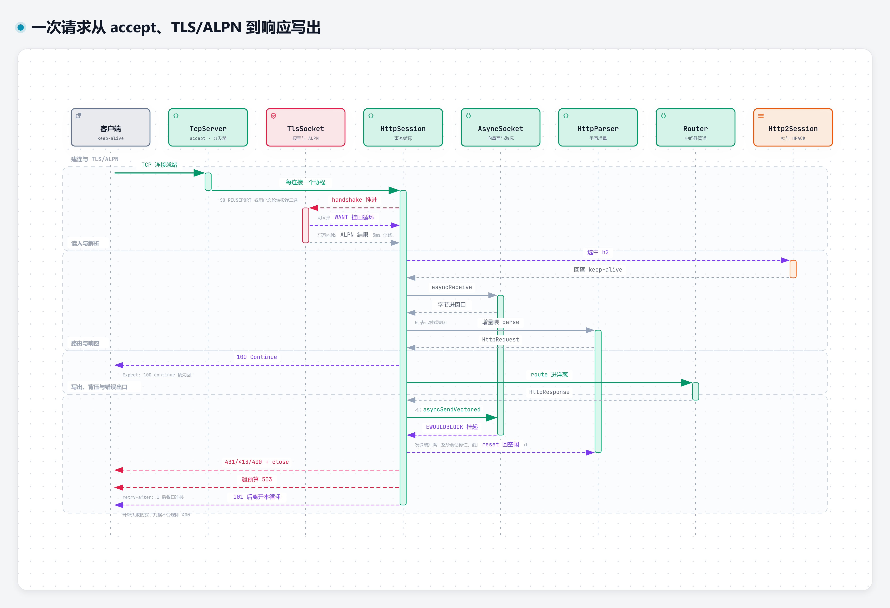
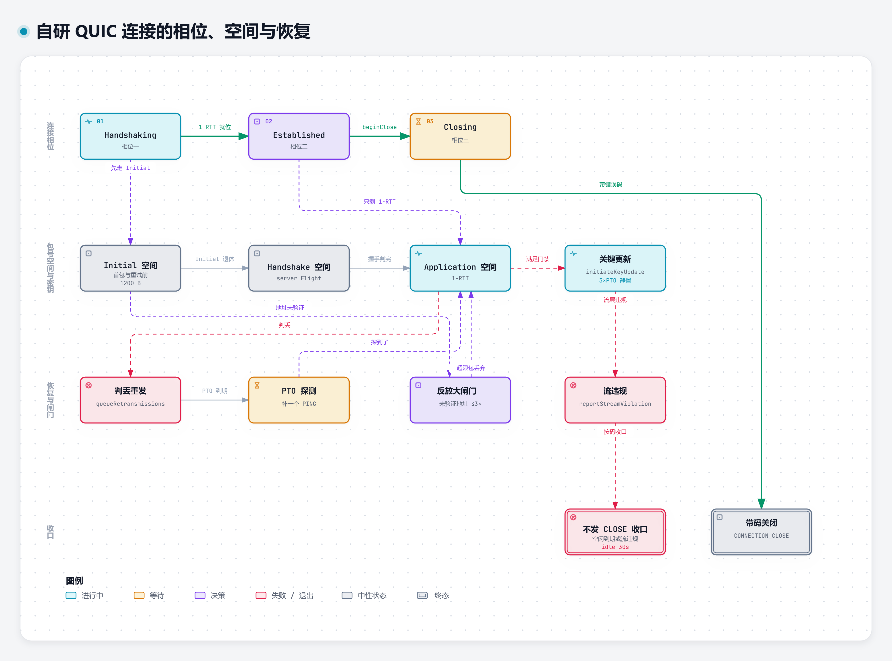

# 网络编程

[返回文档导航](文档导航.md)

本文覆盖 TCP/UDP、HTTP 三条通道、WebSocket、出站客户端与文件收发。装配、限额与观测入口分别在 [部署与运维](部署与运维.md) 与 [配置与可观测性](配置与可观测性.md)。

## 服务装配

[](../assets/diagrams/png/http-request-sequence-light.png)

`HttpServer`（明文）与 `HttpsServer`（TLS）都是 `TcpServer` 的子类。`start()` 返回常驻协程：绑定并监听后循环接受连接，达到并发上限时丢弃新连接，否则交给会话协程并发运行。**accept 协程与服务器对象必须由所属事件循环推进，且 Task 要活到服务器收口**——把 `server->start()` 的返回值放进临时作用域，帧会在投递后被销毁。

```cpp
#include "Core/Coroutine/ThreadPool.h"
#include "Core/EventLoop/IoContext.h"
#include "Core/Process/GracefulShutdown.h"
#include "Core/Socket/InetAddress.h"
#include "Net/Http/HttpServer.h"
#include "Net/Http/Router.h"

#include <cstddef>
#include <memory>
#include <vector>

using namespace AsynGyanis;

int main()
{
    Core::IoContext context(2);
    const auto      address = Core::InetAddress::resolve("127.0.0.1", 8080);

    std::vector<std::unique_ptr<Net::HttpServer>> servers;
    std::vector<Core::Task<>>                     accepts;
    for (std::size_t index = 0; index < context.threadPool().threadCount(); ++index)
    {
        auto server = std::make_unique<Net::HttpServer>(context.threadPool().eventLoop(index), *address);
        server->router().get("/", [](Net::HttpRequest &, Net::HttpResponse &response) -> Core::Task<void> {
            response.setStatus(200);
            response.setHeader("Content-Type", "text/plain");
            response.setBody("Hello, AsynGyanis");
            co_return;
        });
        accepts.push_back(server->start());
        servers.push_back(std::move(server));
    }
    for (std::size_t index = 0; index < accepts.size(); ++index)
    {
        context.threadPool().eventLoop(index).scheduler().schedule(accepts[index].handle());
    }

    static_cast<void>(Core::GracefulShutdown::blockStopSignals());
    Core::GracefulShutdown shutdown;
    shutdown.onShutdown([&context] { context.stop(); });
    context.run();
    return 0;
}
```

Linux 每线程一个监听套接字，靠 `SO_REUSEPORT` 由内核分摊；Windows 没有该选项，改用 `startAccepting(distributor)`：一条循环只接受并按轮转把连接交给工作循环（`ConnectionDistributor`）。两种形态都要求 `start()`/`stop()`/`drain()` 在服务器所属循环线程上调用——连接容器与协程调度不做跨线程保护。

路由器支持精确匹配、`:id` 参数段与 `*` 通配；命中的模式原文由 `HttpRequest::matchedRoute()` 交回，按路由分组打点不必自己再拼。中间件是洋葱模型。

## HTTP/1.1 与 HTTP/2

- **HTTP/1.1**：手写增量解析器，Keep-Alive 持久连接，分块编码与 trailer。请求目标、头部条数与长度、正文大小都有显式上限，越限分别回 414/431/400/413，而不是把畸形输入喂进会话。
- **HTTP/2**：RFC 9113 帧与连接状态机、自研 HPACK（含 Huffman）、接收窗口流控、流式响应、GOAWAY 优雅排空；支持 h2c 明文与 RFC 8441 扩展 CONNECT 隧道。
- **HTTPS**：TLS 握手 + ALPN 协商（h2 / http/1.1）、mTLS、证书热轮换（`reloadCertificate()`）。

过渡响应（1xx）在三条通道一律「照解不照收」：h1 按 RFC 9110 §15.2 丢弃后继续解析，h2/h3 同样丢弃且不占用「一条流唯一的最终响应」那个位置。带 END_STREAM 的 1xx、最终状态码之后不带 END_STREAM 的头块、只发过 1xx 就收尾这三种形状按 RFC 9113 §6.2/§8.1 落成流错误 PROTOCOL_ERROR，而不是打死整条连接。

## HTTP/3 与 QUIC

[](../assets/diagrams/png/quic-connection-lifecycle-light.png)

QUIC 传输层按 RFC 9000/9001 实现：握手、流与流量控制、丢包恢复、拥塞控制可插拔（缺省 NewReno，可切 CUBIC——RFC 9438 的 β=0.7 乘性减、三次曲线、1.5× 上限、Reno 友好区与快收敛）、持久拥塞重启与 ECN 处置（RFC 9002 §7.1/§7.6）、1-RTT 密钥更新。HTTP/3 会话层同样是自研的：帧层、QPACK（含动态表）、流式正文、GOAWAY 排空、RFC 9220 扩展 CONNECT 隧道。

- 同一个端口号的 UDP 上提供 h3，QUIC 自带 TLS，因此 `QuicServer` 需要证书而不需要外层 TLS。
- 收包与发包按批交付：一次就绪用 `recvmmsg` 收多条，一轮 flush 攒出的报文用 `sendmmsg` 交出。Windows 两个方向都没有批量入口，按逐条退化，交付语义同形而系统调用次数不同。发送侧不套 `UDP_SEGMENT`：GSO 要求整批等长，为凑等长补 PADDING 是把系统调用省在发包侧、把字节加在线路上。
- ECN 是平台相关的：Windows 既读不到 IP 头的 ECN 字段也没有按报文设它的入口，那一侧从一开始就不带标、也不报计数（`Platform::DatagramSocket::supportsPerDatagramEcnField()` 报这个事实）。
- 在途 QUIC 连接状态不可跨进程转移。换代后老连接收到的是无状态重置，两个实例必须共用同一份 `--stateless-reset-key`，否则客户端只能等自己的超时。

## WebSocket

RFC 6455 握手与帧编解码，入站与出站共用同一套帧机制。

- 文本帧的 UTF-8 两个方向都把关：对端发来非法序列按 1007 收口，本端要发非法的那条当场拒——自己不收的帧不发。
- 分片重组、有界收帧队列。`remoteCloseCode()` / `remoteCloseReason()` 交出对端 Close 帧的原值与原因文本；非法 UTF-8 的原因不外交给业务。
- permessage-deflate（RFC 7692）按对端声明的窗口位数协商；本端无法履约就不接受该扩展，而不是带着解不开的窗口开连接。要约里出现未定义的参数名或同名参数重复按 §7692 §9.1 婉拒。
- 主题扇出归 `WebSocketHub`：订阅是 RAII 句柄（析构即除名），一条连接同一时刻只有一个写者，每个成员自带待发队列的字节上界。越界丢**最新**的一条，条数从 `droppedMessageCount()` 读；对端收口或写失败而整队作废是**另一本账**（`abandonedMessageCount()`）——合成一条就分不出「该调上界」与「只是断连」。
- 版本不合按 §4.2.2 回 426 并指明本端支持的版本。

## 静态文件与流式正文

- `staticFileDir()` 一行接入静态资源。条件请求一并给出：`ETag` + `Last-Modified`，`If-None-Match`/`If-Modified-Since` 成立回 304、`If-Match` 不成立回 412，判定顺序按 RFC 9110 §13.2.2；两种验证器的比较规则公开在 `HttpConditionalValidators.h`。
- `staticPrecompressedVariants()` 打开后按 `Accept-Encoding` 直接发构建时压好的副本（`.zst`/`.br`/`.gz`，默认关闭）。正文、长度、区间与验证器一律取自**实际发出去那一份**，因此两份表示各有自己的 ETag，跨变体的条件请求不会互相命中；开着这一格就无条件发 `Vary: Accept-Encoding`。
- `staticCompressionDictionary()` 再叠一层 RFC 9842 压缩字典：字典文件自身的响应带 `Use-As-Dictionary: match="..."`，此后客户端按 `Available-Dictionary` 回送哈希。「连接是 TLS + 变体协商开着 + 哈希逐字节相等 + 同目录有 `.dcz` 副本」四条齐了才优先发 `Content-Encoding: dcz`，缺一条就退回常规协商；明文连接上既不宣告字典也不发 dcz（RFC 9842 §8 只许安全上下文）。`.dcz` 副本由部署方用同一本字典离线压出。
- 流式路由 `postStreaming()` / `putStreaming()` 边收边交。`RequestBodySpool::capture()` 把正文一段段写进临时文件：内存里只有当前那一段，写动作经 `Core::AsyncExecutor` 离开事件循环线程。超过上限或正文没收齐会**拒掉并删掉半份文件**。它不改协议判定——`server.parser_limits.maximum_body_size` 那道声明长度的闸照旧先落，要接更大的上传先抬那一项。

## 认证与安全响应头

- `securityHeadersMiddleware()` 一处挂载 `X-Content-Type-Options: nosniff`、`X-Frame-Options`、`Referrer-Policy`，按需再加 CSP / Permissions-Policy / Cross-Origin-Resource-Policy。`Strict-Transport-Security` 只在**加密连接**上发——判据是 `HttpRequest::overTls()` 这一跳的本端事实，刻意不看 `X-Forwarded-Proto`（那句谁都能写）。取值含 CR/LF/NUL 在构造期就抛；配了 `preload` 却没配 `includeSubDomains` 同样当场拒绝。已存在的头不覆盖。
- `basicAuthMiddleware()`（RFC 7617）按路径名单挂闸，凭据判定交给 `verify`。默认**不在明文连接上收 Basic 凭据**：回 403 而不是 401，因为 401 等于邀请客户端把口令发进不加密的信道。同名多条 `Authorization` 按未授权处理；口令按**第一个**冒号切分（user-id 不允许冒号，含冒号的口令因此能用而用户名不能）；`realm` 含引号或 CR/LF/NUL 构造期就抛。
- `bearerAuthMiddleware()`（RFC 6750）把「这条令牌算不算」交回 `verify`，本层管拆头、路径名单、明文连接判据与挑战头。挑战按 §3.1 分两种形状：没给凭据只带 `realm`，给了但不接受才附 `error="invalid_token"`——合成一条就是对没登录的客户端谎报「你手里那条被拒了」。空凭据与「方案不是 Bearer」一起按没给处置。

## 出站客户端

`HttpClient` 带按主机归组的 Keep-Alive 连接池，TLS 侧 ALPN 通告 `h2,http/1.1`。

- 协商到 h2 时多条请求并发复用同一条连接（头块按最大帧负载切片、按流发送窗口、见顶前主动换连接）。已经写上通路而没等到答完的请求**不重发**——非幂等请求做两遍比失败更坏。规范保证「这条请求没被处理过」的那几种收法（h2 的 REFUSED_STREAM 与 GOAWAY 通告值之上、h3 的 GOAWAY 与 H3_REQUEST_REJECTED）才会让非幂等方法也换条连接重来一次，其余一律按「可能已经执行过」处置。
- 失败交回一句点明断在哪一段的中文原因（`std::expected`）。本端判定的畸形响应不再被说成「对端复位了这条流」，对端复位时它给的应用层错误码也一路交上来。
- `HttpClientResponse::retryAfter()` 把 `Retry-After` 的相对秒数与 HTTP-date 两种写法折成「还要等多久」，读不懂交回空而不是 0 秒。`resolveUrlReference()` 把 `Location` 的相对写法按 RFC 9110 §5.3 折成绝对 URL；非 http(s) 协议名、URL 内嵌凭据、含空白或控制字符的引用一律交回空，而不是编造一个下一跳。
- 出站响应的**尾部字段**与响应头部各存一张表（`trailers` 与 `trailerValue(name)`），h1 的 chunked 尾段、h2 的尾段头块、h3 的尾段三条通道都收得下。混成一张表时消费方读不出「这是收完正文才知道的那个结果」。
- `followRedirects` 默认关。开着时按状态码折算下一跳（303→GET、301/302 只折 POST、307/308 原样重放方法与正文），跨源那一跳剥掉 `Authorization`。时限按整条请求算——每跳只花剩下的预算，不会变成「总时限 × 跳数」。正文是一次性拉取的、设了响应正文接收口、或跳数越过 `maximumRedirectCount` 时**不跟**，把那条 3xx 原样交回并打一行原因。
- 代理：认 `http_proxy` / `https_proxy` / `no_proxy` 环境（大小写都认、小写优先，`no_proxy` 支持 `*`、域后缀含子域与 `:port` 限定），也可传显式 `HttpProxyPolicy`（显式值优先；`consultEnvironment=false` 整体关掉环境识别；构造时读一次冻结，静态 `get/post/send` 每次现读）。明文目标按 RFC 9112 §3.2.2 走绝对形式请求目标；`https` 目标先发 `CONNECT host:port`（头区 8 KiB 上限、吃请求剩余预算、非 2xx 与 407 各自点名，200 之后抢跑的坏代理当场拒绝），隧道里的 TLS 仍按**目标**的 SNI 与主机名校验。`https://` 代理表示 TLS 连到代理自身（缺省 443，与目标 scheme 无关）：先与代理按**代理主机名**握手（到代理的一路刻意不声明 ALPN——绝对形式与 `CONNECT` 都是 h1 语义），`http` 目标在其上走绝对形式、`https` 目标在其上做内层 TLS（TLS-in-TLS）。坏配置一律拒绝而**不静默直连**（`socks5://` 等未知 scheme 也在此列，凭据在错误文案里打码）。被代理命中的请求跳过 h3（QUIC 不经 HTTP 代理）；重定向逐跳按当跳 URL 重解析代理与豁免表。
- h3 出站：`HttpClient::setHttp3Enabled`（默认关）。每条 https 出站先试 h3，探不通、起步没走完或那条流没答话都回落到 TCP；明文与流式上传恒走 TCP。

## 取消、超时与过载

- 处理器时限由 `applyRequestTimeoutMiddleware()` + `server.handler_timeout_ms` 给（0 = 不设）。这是每请求的**软**时限：到点把协作式取消交给业务、业务返回那一刻才改写响应，所以不查 `request.cancelToken()` 又不返回的处理器拿不到这条 504。h1 上处理器的执行本来就归 `limits.write_timeout_ms` 管，这一格是叠加的一层。
- 对端取消：h2 收到 RST_STREAM、h3 收到 RESET_STREAM 时当场交进 `request.cancelToken()`。h1 在处理器执行期间不并发读这条连接，对端中途 FIN/RST 要等业务返回才看得见。WebSocket 隧道在三条通道都由 `peer.receive()` 自己收口，不走这个令牌。
- 业务把阻塞活交给 `Core::AsyncExecutor::submit()` 而被拒时抛 `ExecutorSaturatedException`，三条通道的异常出口认出它并回 503 + `retry-after: 1`；停机期的拒绝（`RejectedByShutdown`）不改判——那是生命周期用错，重试一百次还是错。其余异常照旧 500。

## 平台与协议边界

- 只有 Linux 与 Windows。macOS/BSD 在配置阶段被拒绝，没有 kqueue 后端。
- `SO_REUSEPORT` 与 `sendmmsg`/`recvmmsg`、ECN 读写、`TCP_DEFER_ACCEPT`、监听套接字交接都是 Linux 侧能力；Windows 上对应路径按「不支持」退化或明确拒绝。
- 每线程监听与接受分发是两种不同的多核扩展形态，Windows 只有后者可用。
- 限额的键值、生效值与读数口径见 [配置与可观测性](配置与可观测性.md)；HTTP/3 的限额、路由、监听地址、线程数与运维令牌按启动期定型，不随热重载换代。
