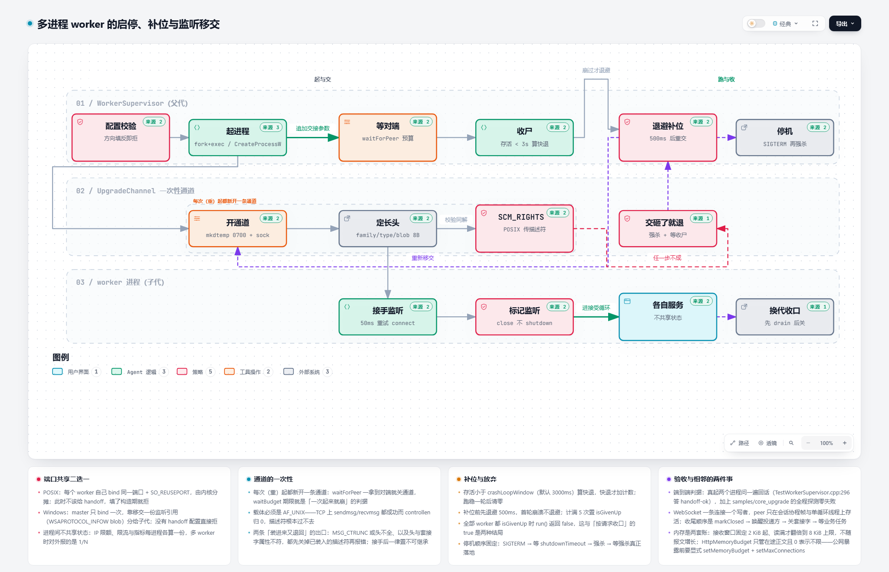
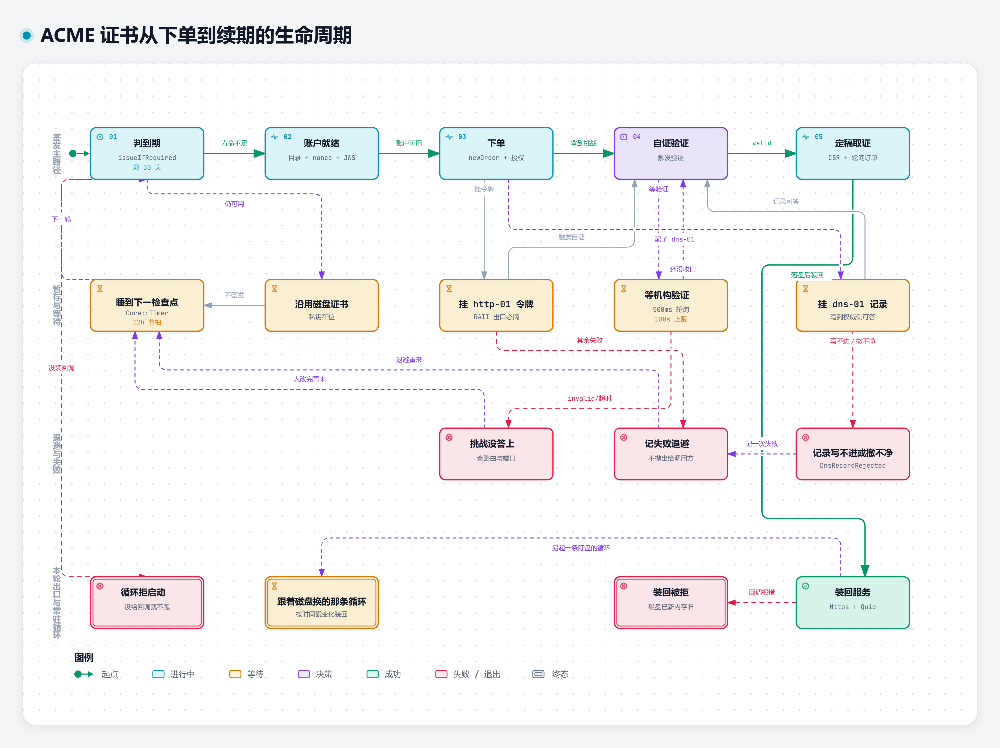

# 部署与运维

[返回文档导航](文档导航.md)

本文覆盖怎么把服务跑起来、怎么停、怎么换代，以及 TLS 与证书自动化的部署边界。采集什么、读数怎么解释在 [配置与可观测性](配置与可观测性.md)。

## ReferenceServer

`samples/Net/ReferenceServer.cpp` 是部署形态的参考实现，随构建一起编译。

```bash
./build/debug/samples/ReferenceServer --port 8080 --threads 4                 # HTTP
./build/debug/samples/ReferenceServer --https --cert cert.pem --key key.pem   # HTTPS
./build/debug/samples/ReferenceServer --https --cert cert.pem --key key.pem --h3   # 同端口的 UDP 上再提供 HTTP/3
./build/debug/samples/ReferenceServer --port 8080 --threads 4 --dispatch-accept    # 一个监听器 + N 个工作循环（Windows 多核请用这个）
./build/debug/samples/ReferenceServer --port 8080 --threads 4 --pin-threads         # 每条工作循环线程绑一枚逻辑核
./build/debug/samples/ReferenceServer --port 8080 --workers 4                       # N 个 worker 进程服务同一端口（POSIX）
./build/debug/samples/ReferenceServer --config server.yaml --https                  # 配置驱动，含 acme 常驻续期
./build/debug/samples/ReferenceServer --check-config --config server.yaml           # 只校配置，不 bind 任何端口
./build/debug/samples/ReferenceServer --help                                        # 全部参数
```

Windows 的产物在 `build/debug/samples/`（共享形态在 `build/debug/bin/`），路径分隔符按平台。

内建端点：`GET /`、`GET /json`、`GET /bench`、`GET /big`（256 KiB 可压缩正文，`--compress` 的验收对象）。运维端点（`/metrics`、`/healthz`、`/readyz`、`/debug/*`）默认**一个都不注册**，见 [配置与可观测性](配置与可观测性.md)。

**配置预检**：`--check-config` 读完配置，并把引用到的文件真打开解析一遍——证书读得出且与私钥配对、`server.tls` 里的取值被 OpenSSL 接受、票据密钥与无状态重置密钥读得动、CA 与 CRL 在位。全部通过退 0 并打一行「配置可用（含 N 处文件校验）」，任何一处不成立退非 0 并点名是哪一格。它不 bind 任何端口，因此可以与正在跑的实例并存；systemd 里它的天然位置是 `ExecStartPre=`（单元样例 `packaging/asyngyanis.service.example` 已带），效果是配错的证书停在「起不来」，而不是「起来了而每条握手都失败」。它**不覆盖** `acme` 与监听器之间那条「有没有 TLS 口可装回」的装配自洽判据——那一条要数真对象才成立。

## 多进程 worker

`Core::WorkerSupervisor` 拉起 N 个 worker 同端口服务、崩溃即补位；**进程间不共享状态**（路由、连接池、指标注册表各一份）。

- 分摊形状按平台分叉：POSIX 上每个 worker 自己 bind 同一端口（`SO_REUSEPORT`）；Windows 没有那个选项，多个进程各自绑只会让最后绑上的一个收到全部报文，于是改由 master bind 一次、把套接字逐个复制给 worker。
- 两种启动顺序不许混用：接手来的服务端再去 bind 会把交过来的那份静默闲置，端口上看着在监听却收不到报文。
- `workerCount` 必须 ≥ 2；崩溃窗口 3 秒、连续 5 次「起来就崩」不再补位；`shutdownTimeout` 默认 10 秒。构造期就校验：Windows 缺 `handoff`、POSIX 给了 `handoff` 都直接抛。
- `ReferenceServer --workers` 只走 POSIX 那条（Windows 上缺移交档位，构造即抛）；移交形状见 `samples/Core/Worker.cpp`。
- master 被硬杀时 worker 随作业对象一起被终止（Windows `killWithParent`、POSIX `PDEATHSIG`）；宿主不让挂作业时保护缺席会落一条 WARN。
- 整机限额按 `workerProcessCount × listenersPerProcess` 摊到每台，启动时打两行读数说明本台真正卡多少；口径见 [配置与可观测性](配置与可观测性.md)。

## 启停顺序

固定序列，先摘流量再收口——顺序反了会把在途请求丢掉：

1. **摘流量**：打 `/readyz` 应回 **503 + `retry-after: 1`**（`stop()` / `drain()` 之后即如此）。这就是编排器把本台移出负载的窗口。这期间 `/healthz` 仍回 200——把存活探针接成「readyz 非 200 就杀进程」才会真丢请求。
2. **收口**：`drain(时长)` 等在册连接归零，到点后强关。多 worker 形态的 `shutdownTimeout` 要大于最长在途请求，否则时限先到、请求被掐。
3. **进程终止**：POSIX 是 SIGTERM；Windows 没有信号——编排者给每个 worker 独立进程组再发 `CTRL_BREAK`（`Process::requestTermination()`）。宿主没有控制台时发不出去，会记一条 WARN 再强杀。

`Core::GracefulShutdown` 把这套信号接管收进库里：POSIX 是 SIGINT/SIGTERM，Windows 是关闭、注销、关机五类控制台事件。收尾动作一律投回构造时给出的那个事件循环执行——服务器与会话的状态按本库的线程契约只允许在所属循环上读写。一个进程只允许一个观察者；第二个实例不装处理器、`isInstalled()` 返回 false 并记一条 ERROR，不静默降级。POSIX 侧要求尽早构造（在其它工作线程创建之前），否则已跑起来的线程仍可能自己收到信号并按缺省动作终止进程。

## 零停机换代与 socket activation

[](../assets/diagrams/png/worker-handoff-workflow-light.png)

两条入口合成一份待接手列表：`--adopt-fd N`（脚本或容器编排传号）与 `Core::activationListenerDescriptors()`（systemd 的 `LISTEN_FDS`/`LISTEN_PID`）。按形状分诊：流监听器交 `HttpServer(loop, fd)` / `HttpsServer(loop, fd, ...)`，已绑定的数据报交 `QuicServer(loop, cfg, socket)` 并改用不带地址的 `listen()`。

- 端口与配置不符就当场退出，不退化成自己再 bind（那种形状看起来是「换代之后服务不见了」）。
- 与 `--workers`、`--dispatch-accept` 不同用（描述符不随 exec 传给 worker），撞上直接报错。
- 开 `--h3` 而只交来 TCP 那一枚按「接管一半」退出；`.socket` 单元要同时写 `ListenStream=` 与 `ListenDatagram=`。
- 在途 QUIC 连接状态不可转移，换代后老连接收到的是一条无状态重置；两个实例必须共用 `--stateless-reset-key`，否则客户端只能等自己的超时。
- Windows 侧没有这条路（描述符不随 exec 继承），单元样例只适用于 Linux。
- 换代后老连接那条会话标识换回的令牌，与交棒方在传输参数里宣告的那枚逐字相同；另一枚按 RFC 9000 §10.3.2 用同一份密钥现算。

## 服务管理器的状态与看门狗

- **就绪上报**：`Platform::ServiceNotification` 按 sd_notify(3) 的形状把 `READY=1` / `STOPPING=1` 与一行 `STATUS=` 交进 `$NOTIFY_SOCKET`（文件系统路径与 Linux 抽象命名空间两种地址都支持，`vsock:` 明确拒）。没有这个变量时报「本进程不在监督之下」而不是静默成功。上报点在**监听器确认之后**，否则 `Type=notify` 会在端口上还没人守的时候判定启动完成，`TimeoutStartSec` 随之失去意义。
- 多 worker 形态由 **master** 报一条 `READY=1`（`WorkerSupervisor` 的 `onAllWorkersRunning`），worker 自己不再碰这条通路——它们继承的是父进程那份 `$NOTIFY_SOCKET`，各报一条会让监督者收到 N 份重复就绪。这条就绪只到**进程级**（N 个 worker 都在跑）；端口是否已在应答由各 worker 自己的日志与 `/readyz` 交代。
- **看门狗**：`Core::ServiceWatchdog` 按 sd_watchdog_enabled(3) 读 `$WATCHDOG_USEC`（窗口折半就是要喂的节拍），把这条心跳**挂在事件循环上**：线程池的每条循环各跑一拍，全部循环都在本轮里醒过一次才发一条 `WATCHDOG=1`。用一条独立线程喂等于把「循环卡死」报成健康，而那正是这条通道唯一要抓的形态。`$WATCHDOG_PID` 指的不是本进程就一条都不喂；窗口读不出、小到折不出 1 毫秒、通知通路没开，各退在自己那一句原因上，并且一条协程都不挂。
- 多 worker 也有节拍：master 为每个槽位建一条心跳管道，worker 侧 `Core::WorkerHeartbeat` 用同一套「每循环一拍、凑齐一轮才写一个字节」的骨架把心跳打回来，master 收齐**所有未放弃槽位**本窗口内的拍才喂。任何一条 worker 的事件循环卡死都会让汇聚停喂。Windows 没有 systemd 看门狗，这一路不启用。
- **配置重读**：`Core::ReloadSignal` 把 SIGHUP 接到注册的重载动作上（systemd 的 `ExecReload=` 默认就是 `/bin/kill -HUP $MAINPID`）。一次 HUP 重读配置文件并重装 `logging` 段、按 `server` 段换新一代连接限额（只影响此后新建的连接，已建立的不打断），同时按 `RELOADING=1` → `READY=1` 成对讲回监督者。注册表跨轮次保留。多 worker 下 HUP 落在 master 上，重读的是 master 那份配置、状态也只由 master 报；要逐位重读请分别对各 worker 的 pid 发信号。Windows 没有这条约定，`isInstalled()` 恒假并说明原因，那边的重载入口是文件监听。

## TLS 与加密策略

服务端策略从 `server.tls` 段来（`minimum_protocol_version` / `maximum_protocol_version` / `cipher_list` / `tls13_cipher_suites` / `supported_groups` / `security_level` / `certificate_authority_file` / `certificate_authority_path` / `verify_depth` / `revocation_list_file` / `revocation_covers_whole_chain` / `session_tickets` / `allowed_peer_sha256_fingerprints`，外加 `require_client_certificates`），程序侧是 `Core::TlsPolicy`。出站另有 `HttpClient(loop, poolConfig, tlsPolicy)`。

- 默认：服务端 TLS 1.2；QUIC 恒 1.3；**客户端角色不补下限**——替调用方发明下限会把本可以连上的对端拒掉。要给出站也钉下限，就显式传 `minimumProtocolVersion`。
- TLS 1.0/1.1 没有档位可填（RFC 8996 已废弃）。
- 确认生效：`TlsContext` 建好后读 `SSL_CTX_get_min_proto_version`，或抓一次握手看协商版本。实跑判据：配 `minimum_protocol_version: TLS1.3` 后 `openssl s_client -tls1_2` 被拒（`Cipher is (NONE)` + `tlsv1 alert protocol version`，alert 70）而 `-tls1_3` 正常；`cipher_list` 只留一条套件后其它套件报 alert 40 handshake failure。
- 对端身份点名走 `allowed_peer_sha256_fingerprints`（mTLS 从「CA 签的都对」收窄到指纹点名）。

## 证书自动化（ACME / RFC 8555）

[](../assets/diagrams/png/acme-certificate-lifecycle-light.png)

`AcmeCertificateManager` 走完目录、账户、下单、自证、定稿与取证这一整台状态机：私钥与证书原子落盘（私钥 0600），到期前自主续，签好后经回调装回服务。协议层（`AcmeClient`）与密钥层（`AcmeKeyPair`：JWK、RFC 7638 指纹、JWS、CSR）都能单独用。h3 那一侧由 `QuicServer::reloadCertificate()` 承接同一个轮换动作，443/TCP 与同一端口的 UDP 不会一张新一张旧。

配置段（`ReferenceServer --config` 或 `acme_issuance_probe --config`）：

```json
{
  "acme": {
    "enabled": true,
    "directory_url": "https://acme-v02.api.letsencrypt.org/directory",
    "domains": ["shop.example.com", "*.shop.example.com"],
    "certificate_file": "certs/chain.pem",
    "private_key_file": "certs/domain-key.pem",
    "account_key_file": "certs/acme-account-key.pem",
    "account_state_file": "certs/acme-account.json",
    "contact_email": "ops@example.com",
    "tos_accepted": true,
    "challenge": "dns-01",
    "renew_before_expiry_days": 21,
    "dns": { "provider": "aliyun", "domain": "shop.example.com", "record_ttl_seconds": 600 }
  }
}
```

三条口径：

- **凭据不认配置文件**。`dns.provider` 只说明用哪一家的动作，AccessKey 一律从 `ASYN_ACME_DNS_ACCESS_KEY_ID` / `ASYN_ACME_DNS_ACCESS_KEY_SECRET` 读，缺任何一条就在 `buildDns01TxtWriter()` 当场拒——一把能改域名记录的钥匙进了版本库，等于把域名交出去。
- **`dns` 段与 `challenge` 互为条件**，两个方向都拒：写了 `dns` 却没走 dns-01 是有人改了一格忘了另一格，按字面继续跑会让人以为 TXT 在写。
- **段内未知键即拒**（13 个键 + `dns` 那 3 个）。键名打错不该安静地按默认跑。

默认值与边界：整段缺失即 `enabled` 为 false，谁都不去签；`challenge` 默认 `http-01`；`dns.record_ttl_seconds` 默认 600（下限也是 600——这一家实测拒更小值，配低了在**读配置**时就拒，不留到第一次签发才在 API 上报 `The specified TTL is invalid`）；`renew_before_expiry_days` 30；`renewal_check_interval_minutes` 720。

自证支持 HTTP-01 与 DNS-01（RFC 8738）两种，一次签发只走一条：默认 HTTP-01，构造时交来 `AcmeDns01TxtWriter` 就改走 DNS-01——后者**不需要任何入站通路**，被备案拦截或 80 端口不可达的部署也能自动续期，且这是通配域名（`*.example.com`）唯一可行的自证方式。TXT 写入动作交给你接的那家 DNS，仓库内自带阿里云云解析的实现。**tls-alpn-01 不做**：机构只给那一种时当场判失败并说明要哪一种，不会挑一条答不了的挑战去 POST。

三条部署边界都写成启动即拒（或启动即说清），因为它们全是「配了但不会生效」的形状：

- **开着 `acme` 时证书身份以 `acme` 的落点为准**：`--cert/--key` 与它不一致会被顶掉并打一行 WARN 说明顶掉了什么。两边不同解就等于签完装不回去——`reloadCertificate()` 按监听器原来那条路径重读，新那张写在别处。
- **`http-01` 在本示例里装不下去**：它要一台公网可达的明文监听器，而这里一个端口只服务一种协议，开了 `--https` 就没有明文口，于是启动被拒并指回 `dns-01`；`http-01` 的一次性签发仍归探针（它自带明文对端）。
- **多 worker 进程：签发只归槽位 0 那个进程，其余进程跟盘**。机构的速率限制按账户计而不是按进程计，N 份管理器各撞一次额度毫无意义；签发进程落盘是原子替换，「那张文件的身份变了」就是它唯一需要发出的通知——其余进程用 `Net::followCertificateRotation` 每 15 秒读一次 (字节数, 修改秒, 身份标记) 三元组，任一不同就重装本进程的 TLS 监听器。跟盘的进程因此**不需要**那对能改域名记录的凭据。

首次签发不在服务侧：落点上还没有可加载的身份时 `ReferenceServer` 启动即失败并说明「先用 `acme_issuance_probe` 跑一次」，而不是把一句 OpenSSL 的 PEM 解析错误留给人猜。停机排在停服务器之前：先叫停 ACME 的常驻协程（续期循环与跟盘协程各一条），再等它们**真的**退出（有界——停放一片 1 秒，等待上限 5 秒；正在进行的那一轮签发刻意不打断，半途掐掉会留下半个订单状态）。

`runRenewalLoop()` 在没有装回服务动作时**拒绝启动并把原因记进 `status()`**，不会静默地只往磁盘上写——磁盘上的证书每月在换、线上身份永远是那张旧的，是这类自动化最坏的失败形状。下一轮什么时候再试由 `nextRenewalDelay()` 一处算出（取「查到期节拍」与「失败退避」里更晚的那个，但欠着一次装回时压回短片：那种情况下等到 12 小时不是保守而是漏掉）。

**一份单里同时写 `example.com` 与 `*.example.com` 时，第二次自证会先等满记录 TTL。** RFC 8738 让这两条自证落在**同一个**名字 `_acme-challenge.example.com` 上，而两条的答案不同；机构按那条记录的 TTL 缓存答案，先撤后写之间没等满就会读到上一条，原文只回 `Incorrect TXT record "…" found at _acme-challenge.example.com`。实测这个区把 TTL 压到 60 或 300 秒都会被 API 直接拒（`QuotaExceeded.TTL`，地板是 600 秒），所以「调小 TTL」这条路在免费区上不成立——写入器改成记住刚撤过的名字、同名重写之前等满 TTL（上限 15 分钟）。这段等待只在进程内记，所以**接连重跑两次签发之间也要隔过 TTL**。

## 容器与安装

- Dockerfile 在 `packaging/Dockerfile`：静态 Linux 构建 + 非 root 用户 + `WORKDIR /var/lib/asyngyanis`。配置样例里的日志目录是相对路径（`directory: logs`），而进程以非 root 跑——没有一个自己写得动的工作目录，滚动文件 sink 就会在 `/logs` 上吃 EACCES 而整段日志配置白配。
- systemd 单元样例 `packaging/asyngyanis.service.example`（`Type=notify`、`ExecStartPre=` 配置预检、`ExecReload=`、看门狗窗口）。
- 安装与包消费见 [入门与构建](入门与构建.md)。

## 加固

`ASYN_ENABLE_HARDENING` 默认 ON：GCC/Clang 落 `-fstack-protector-strong`（每个非 sanitizer 档）+ Release 的 `-D_FORTIFY_SOURCE=2` + 链接侧 `-z relro,-z now`；MSVC 编译与链接都带 `/guard:cf`（只进 Release）。开 sanitizer 时整体不叠（配置期打一行说明）。

加固只落**本仓自己的产物**，且全部 `PRIVATE`：链接期策略（`-z now`、CFG）刻意不推给消费者——静态库的消费者可能用 `--no-pie`、纯静态 glibc 或自己一套 CET 策略。所以**最终可执行体那侧要自己开**：只在库里加选项而可执行体没带链接期 CFG / FULL RELRO，读到的是「库编过了」而线上镜像照样没有那道防线。核它：`python scripts/check-hardening.py --build <构建目录>`（期望从该构建目录自己的 `CMakeCache.txt` 现读；「配了没重新 configure」「找不到 readelf」「这一档根本没链接出产物」都退 2，不会被读成通过）。

## 出问题时先看哪里（生命周期类）

| 症状 | 先看 | 怎么读 |
| --- | --- | --- |
| 服务管理器显示启动完成，但端口没人守 | 上报点位置 | `READY=1` 必须在监听器确认之后发。用独立证据核：把 `$NOTIFY_SOCKET` 指到自己 bind 的 AF_UNIX 数据报套接字，应逐条收到 `READY=1`、`STATUS=…`；`--workers N` 时 `READY=1` 必须**只有一条** |
| 进程活着但不再服务 | 看门狗是否停喂 | 节拍由循环驱动：把任一条循环占住（压一个几百毫秒的长任务），单进程侧节拍必须**停下来**，放开后恢复。只喂不判的实现这一格会照样绿 |
| 换代之后服务不见了 | 交接口径 | 端口与配置不符会当场退出而不是自己再 bind；`--adopt-fd` 与 `--workers`/`--dispatch-accept` 互斥；开 `--h3` 只交来 TCP 那一枚按「接管一半」退出 |
| 证书告警 | `asyn_acme_*` 一族 | 到期读数**为 0 不是「已到期」而是「读不出」**（还没签出、或那条路径上真没有读得出的证书）；「没跑成」与「还没跑」在面板上同形，区分看 `issuances_total` 有没有在动；`reload_pending` 单列「盘上已是新的一张、线上还没换上」 |
| worker 反复被补位 | `asyn_worker_crashes_total` / `asyn_worker_slots_given_up` | 崩溃现场是**尽力**写 stderr 的（信号处理器里，不保证送达）。「起来就崩」连续 5 次会停止补位——此时看最后一版启动日志与配置，别等下一次补位 |

读数与端点口径见 [配置与可观测性](配置与可观测性.md)。
