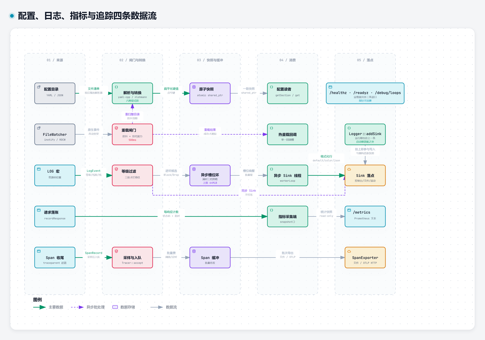

# 配置与可观测性

[返回文档导航](文档导航.md)

本文覆盖配置装载与取值口径、日志、指标与追踪、运维端点，以及「读数怎么解释、异常先看哪里」。启动、停机与换代序列在 [部署与运维](部署与运维.md)。

[](../assets/diagrams/png/config-log-dataflow-light.png)

## 配置装载

`Base::ConfigManager` 支持 YAML 与 JSON：多文件加载与优先级、目录递归装载、点分路径取值、模式校验、热重载（inotify / ReadDirectoryChangesW）。

```cpp
#include "Base/Config/ConfigManager.h"

AsynGyanis::Base::ConfigManager configuration;
configuration.loadFromDirectory("config", /*recursive=*/true);
const int port = configuration.get<int>("server.port", 8080);
```

`ConfigValue` 是 `nlohmann::json` 的别名：成员读取用 `at()`，取值用 `get<T>()`，类型判定用 `is_*()`。仓库不提供自研 DOM、解析选项或兼容接口。几处容易踩的口径：

- 原生 JSON 的正整数是无符号类型（`number_unsigned`）。
- `empty()` 只对 `null` 与空容器为真，**空字符串不算空**。
- `get<T>()` 允许算术类型互转（浮点取整、布尔当数字），因此配置层统一走 `configValueAs<T>()`：bool 只接受布尔、整数只接受整数且目标类型须能无损表示、浮点只接受浮点、其余类型一致才成功。口径是「宁可回落默认值也不静默变形」。
- 非有限浮点（NaN、±Inf）不可表示成合法 JSON 文本，`serializeConfigValue` 交回空而不是悄悄换成 `null`。

YAML 转配置值模型的规则：引号标量一律按字符串、`!!str/!!int/!!float/!!bool/!!null` 之外的自定义标签直接报错、重复键报错、别名展开设深度与节点总数上限；标量按 YAML 1.2 核心 schema 识别（`yes/no/on/off` 是字符串）。JSON 与 YAML 直接使用 [nlohmann_json](https://github.com/nlohmann/json) 与 [yaml-cpp](https://github.com/jbeder/yaml-cpp) 的原生接口（JSON Pointer/Patch/Merge Patch/SAX、YAML 多文档与事件），两库都是 `Base` 的公开传递依赖。原生接口分别抛 `nlohmann::json::exception` 与 `YAML::Exception`，配置加载边界把错误汇入 `ConfigLoadResult::errors`。

**未知键的策略按段不同**，这是刻意的：`server` 与 `acme` 段未知键当场拒（配了不生效比报错更伤）；`logging` 段只报不拒——sink 的字段集按类型多态，因一个多余字段就丢掉整条 sink 比现状更伤，但它会打一行 `stderr` 并报出这一层认识哪些字段（含 `max_backups` 这类拼错的键）。

## 限额与背压

装配只有一处入口：`applyHttpServerConfiguration(server, configuration, context)`（`src/Net/Http/Server/HttpServerAssembly.h`）。当传入的共享限额器与配置标量不一致时**当场拒绝**——多条通道共用一份限额器时，静默挑一边会让「配置写 16、实际跑 64」完全看不出来。

| 键 | 默认 | 说明 |
| --- | --- | --- |
| `server.parser_limits.*` | 头部 100 条 / 单值 8 KiB / 头块 64 KiB / 正文 8 MiB | 请求目标长度、头部条数、单条头名与头值长度这三道闸门在 h1/h2/h3 三条通道上同一判据（h1 由解析器判，h2/h3 在 intake 判，伪头也算一条；条数与头块字节按**整条报文累计**）。h2 的两条长度闸门由 HPACK 解码器执行，上限取自 `parser_limits` |
| `server.limits.*` | 空闲 75s、读写各 60s | 超时与连接级限额 |
| `maximum_connections` | 4096 | **默认是有限值**；写 0 才是显式不限 |
| `maximum_connections_per_ip` | 256 | 单来源限额是给共享出口（运营商级 NAT、企业代理）留的余量；真被撞到的部署应按实测并发抬高它，而不是把闸门关掉 |
| `requests_per_second` | 0（不限） | 限流给默认值会误杀真实用户，方向不对，所以默认关 |
| `memory_budget_bytes` | 0（不限） | 在途正文总量。越界回 503 + `retry-after: 1` |
| `maximum_websocket_message_size` | 8 MiB | 一个数同时管单帧声明长度、分片重组后的总长与 permessage-deflate 的解压输出上限；0 = 不限。三条通道（h1 的 101 升级、h2 的扩展 CONNECT、h3 的 CONNECT 隧道）吃同一份配置 |
| `server.handler_timeout_ms` | 0（不设） | 每请求软时限，见 [网络编程](网络编程.md) |

两条容易读错的口径：

- **h2/h3 的流式路由是明写的例外**：请求已派发，越限只拦得住尾字段而回不出 431。
- 头块**字节**数三条通道都判同一把尺——h2 在 intake 按名与值的净字节判，另有 `setHttp2Configuration()` 那个随 SETTINGS 通告出去的值按 §6.5.2 的「每条 +32」并排判，取更紧的一方生效；两者出厂同为 64 KiB。

**多进程时配置写的是整机口径**：装配出口按 `workerProcessCount × listenersPerProcess` 向上取整摊到每台（`perProcessShare`）。两类限额的分母不同——每台自己计数的限额乘「进程数 × 每进程监听器数」，而一个进程里多台共用的那份共享对象只按进程数摊；乘错了会把闸门压到 1/L。`ReferenceServer` 启动因此打**两行**读数，只印一行就会有一行是假的。本台真正卡多少可问 `TcpServer::maximumConnections()`。`rate_limit` 走同一套摊分但**取整方向相反**：速率精确除（0.5 请求/s 不能被抬成 1），桶容量向下除后兜在 1.0（容量不足一枚令牌的桶一个请求都放不出）。

HTTP/3 不在装配入口里（`QuicServer` 用自己那份 `Configuration`），示例侧逐项接同一份配置，生效值随启动打出。`--h3` 那侧另有一份 `QuicServer` 自带的默认 1024（单位连接更贵，配额刻意不同）。

**能热重载的只有** `logging` 段与 HTTP/1·HTTP/2 的连接限额；HTTP/3 限额、路由、监听地址、线程数、`metrics_port` 与运维令牌按启动期定型，改这些要重启。

## 日志

6 级、4 种 Sink（控制台/文件/滚动/异步）、C++20 `std::format`、带源码位置。

```cpp
#include "Base/Log/LogMacros.h"
#include "Base/Log/LoggerRegistry.h"
#include "Base/Log/Sinks/ConsoleSink.h"

AsynGyanis::Base::Logger &rootLogger = AsynGyanis::Base::LoggerRegistry::instance().getRootLogger();
rootLogger.addSink(std::make_unique<AsynGyanis::Base::ConsoleSink>());
rootLogger.setLevel(AsynGyanis::Base::LogLevel::Debug);
LOG_INFO_FMT("listening on port {}", port);
```

配置侧（`Base::LoggerConfigLoader`）：`global_level` 与 `sinks`（`rolling_file` 有 `directory`/`policy`/`max_size_mb`/`max_backup`）。三种格式化器按 sink 配：`default` / `color` / `json`，写错按 default 处理并打一行诊断。

- 未配置前 root 是 Trace 且**零 sink → 全部丢弃**；`global_level` 缺失回落 INFO；滚动按 `size`、单文件 10 MiB、留 10 份。
- 越界值会被钳制并打到 `stderr`（不中断启动）；`policy` 拼错会回退成 `size` 并说明原因——启动日志要留着看。
- 文件族 sink 另有 `immediate_flush`：**配置层默认开**（写完就交给操作系统，`tail -f`、Filebeat/vector 与崩溃后的取证才读得到），而 `FileSink` 构造的默认是关（程序里自己掌握刷新节奏）。两边默认不同是刻意的；写 `immediate_flush: false` 换回攒缓冲、省一点系统调用，代价是运行期文件可能长时间 0 字节。
- 丢弃有账：`AsyncSink::droppedEventCount()`（每条通道各计各的）与 `Base::droppedAsyncLogEventCount()`（进程级合计）；`FileSink::skippedLineCount()` 是文件没打开或流已失效时按行累计的「落不下盘」数。开着 `/metrics` 时合计落在 `asyn_http_log_dropped_events_total`——队列满按策略丢、Block 策略等位超时、下游落地抛异常三种口径都算进去。
- 报错文案全中文且写清「原因 + 替代做法」；`what()` 带抛出点，不把它原样回给客户端（见安全政策）。
- 对端可触发的告警受时间窗压重：出现「（过去 N 秒内另有 M 条同类被压掉）」时量级在 M 里，连响说明对应的事件流还在持续。

## 指标：拉取

`/metrics` 输出 Prometheus 文本展示格式 0.0.4。HTTP 层统计（状态码标签族、延迟直方图）、`/healthz`、`/readyz`、`/debug/loops`、`/debug/connections`、`/debug/log-level` 都是内建端点。

`Core::ProcessMetricsRegistry::registerMetric(...)` 交回 RAII 把手（析构即注销），`/metrics` 末尾按登记的**完整名字**原样导出。库内非 HTTP 的通道（ACME、TLS 握手、worker 崩溃、Net 的 UDP、Database 的连接池）在对象构造时各自登记，应用不需要接线。

三条容易读错的口径：

1. 这些名字**不套**监听器的 `metric_name_prefix`，抓哪台都是同一份进程量。
2. 同名多实例按登记时给的并法合（计数求和；到期时刻取**最早**那张，因为它是会先出事的那个）。
3. **长期为 0 就是要报的事**——「没跑成」与「还没跑」在面板上是同一个形状。

主要读数：

| 族 | 含义 |
| --- | --- |
| `asyn_http_admission_rejected_connections_total` / `asyn_http_over_limit_rejected_connections_total` | 按来源挡掉的 / 整机满挡掉的连接（两种相反的处置要分开判） |
| `asyn_http_maximum_connections` / `asyn_http_maximum_connections_per_ip` | 分母。只有分子时「离上限还有多远」这类预警画不出来。两条分母是**本监听器**口径，而分子 `active_connections` 在多台监听器共用一份采集端时是**相加的那一份**，两者不同源，别直接相除当负载率 |
| `asyn_http_inflight_body_bytes` / `asyn_http_memory_budget_rejections_total` | 在途正文字节与被预算拒掉的预留次数 |
| `asyn_http_executor_saturated_responses_total` | 因执行器排队已满而被降级应答的请求条数；`asyn_http_blocking_task_rejected_total` 记的是执行器侧拒了多少任务（任何提交方都算），两者不是一回事 |
| `asyn_http_log_dropped_events_total` | 见上一节 |
| `asyn_acme_certificate_expiry_seconds` / `asyn_acme_issuances_total` / `asyn_acme_failures_total` / `asyn_acme_reload_pending` / `asyn_acme_dns01_*` | 证书自动化；到期时刻在构造时就按磁盘上现有那张填过，计划内重启不会先报一段假的 0 |
| `asyn_worker_crashes_total` / `asyn_worker_slots_given_up` | 多进程补位与放弃 |
| `asyn_db_pool_*` | 在借、等待、等待名额被拒、最久在借起点、当下持有、已丢弃、借出超时、会话没复位干净（`session_reset_failures_total` 是「已丢弃」的异常子集）、探针次数、建连重试次数 |
| `asyn_executor_pending_tasks` / `asyn_executor_rejected_total` | 每台执行器各报一份、抓取时求和；后一条涨了说明该降并发或加工作线程 |
| `asyn_tls_handshakes_total` / `asyn_tls_session_reused_total` | TLS 握手与会话恢复 |
| `asyn_quic_datagram_batches_*` / `asyn_quic_datagrams_*` | h3 收/发两侧各一对：两笔相除才是「一次就绪收了几条 / 一次调用交了几条」。Windows 上没有批量入口、按逐条退化，比值照读 |
| `asyn_quic_handshaking_connections` | 在册但未完成握手的连接数。与在线数之差给已验证部分归因——它在涨而在线不动，就是只发 Initial 不推进握手的流量在占名额 |
| `asyn_websocket_hub_dropped_messages_total` / `asyn_websocket_hub_abandoned_messages_total` | 队满丢最新的一条 vs 对端收口/写失败整队作废 |
| `asyn_http_process_open_fds` / `asyn_http_process_max_fds` | 已打开的描述符数与软上限（上限 0 = 平台读不出、不设上限或 Windows 无此口径）；只有已用量时，fd 泄漏要等撞到上限才看得见 |
| `asyn_http_cgroup_memory_limit_bytes` / `asyn_http_cgroup_memory_current_bytes` | cgroup 内存分母与当前用量（`current` 含页缓存；读不出时整条序列不出现；`limit` 为 0 表示内核明确报无限制） |
| `asyn_http_cgroup_pids_limit` / `asyn_http_cgroup_pids_current` | cgroup 进程/线程数分母与当前值（`current` 含同组其它进程，不是本进程的线程数） |

**有两类读数刻意不接**：跨线程不安全的对象（出站连接池明写「协程挂起期间被别的线程驱动会踩坏套接字状态」，而抓取在另一条线程上）与「读口本身带副作用」的（`WorkerSupervisor::runningWorkerCount()` 会顺手回收子进程）。接出口之前先问这两条。

## 指标：推送

`OtlpHttpMetricsExporter` 按周期现取注册表快照发 `POST /v1/metrics`（OTLP/HTTP JSON；Counter 折单调 `sum`、Gauge 折 `gauge`）。配置走 `metrics` 段（`ReferenceServer --config` 已接）或直接编程装配——推与拉两条通路互不排斥，可同时开。HTTP 统计另走一路 `buildOtlpMetricsFromHttpStats`（请求/连接/WS 计数、`responses_total` 的状态码标签族与延迟直方图，前缀 `asyn_http` 与 `/metrics` 同名）。

- 段缺失即关着；`export_interval_ms` 默认 15000、`otlp.timeout_ms` 默认 3000。
- 开了就必须给服务名与采集端地址，缺一项在**读配置**时当场拒（未知键同样拒——`export_interval` 少写 `_ms` 不会被静默忽略）。
- **快照语义**：一个周期失败不补发（下个周期是全量最新值），别把它当可靠队列；空快照的周期直接跳过、一次网络都不碰——「没有指标可报」不是「通路坏了」。
- 出口自己的读数：`deliveredExportCount()` / `failedExportCount()` / `emptySnapshotCount()` / `lastFailureReason()`。

## 追踪与日志的 OTLP 出口

链路追踪与日志各自有 OTLP/HTTP JSON 出口（`/v1/traces`、`/v1/logs`），配置段 `tracing` / `logging` 的 `otlp` 子段。日志是**批语义**：有界队列、失败重试、溢出与收尾丢弃都计数（日志丢了就是丢了）。记录里会带上 trace 上下文字段（`trace_id`/`span_id`/`request_id`）与 `logger.name`、`thread.id`。

## 运维端点与鉴权

`server.expose_metrics` 打开后注册端点；程序侧是 `enableMetricsEndpoint()` / `enableHealthEndpoint()` / `enableReadinessEndpoint()` / `enableLoopDiagnosticsEndpoint()` / `enableConnectionsEndpoint()` / `enableLogLevelEndpoint()`。

- 默认**关**（一个端点都不注册）。不开令牌时那五个端点都不鉴权，而 `/debug/log-level` 干脆不注册——改日志等级是写操作，没有闸门就不留这个入口。
- `server.ops_bearer_token` 给 `/metrics`、`/debug/loops`、`/debug/connections`、`/debug/log-level` 四条加 Bearer 闸门；`/healthz` 与 `/readyz` 刻意不挡（存活与就绪探针要能被编排器无凭据访问，给探针加令牌只会让人把探针关掉）。
- 令牌只能写在配置文件里：命令行上的令牌会进 shell 历史与进程列表。
- `/readyz` 只问「还在不在接新连接」：`stop()` / `drain()` 之后回 503 + `retry-after: 1`，正在排空在途请求的那段就是编排器把这台摘出负载的窗口，而这段里 `/healthz` 仍回 200。
- 访问这些端点本身就是暴露面：`/metrics`、`/debug/loops`、`/debug/connections` 读得到内部计数与每条循环的状态，开到 `0.0.0.0` 等于公开。来源侧的收口要靠只听回环的管理口（下一节）。

`server.metrics_port`（0 = 端点留在业务口上）与 `server.metrics_address`（默认 `127.0.0.1`）：

- `metrics_port` 非 0 时业务口**不再注册那些运维端点**（打过去回 404，这是刻意的反向断言），要抓数得打 `metrics_port + 本进程序号`；多进程下 `ReferenceServer` 由 master 用 `--worker-index` 把序号传下去，逐台各听一个口。
- 只配 `metrics_address` 而 `metrics_port` 仍为 0 = 什么都没挪；把 `metrics_address` 写成 `0.0.0.0` 又不配令牌，等于把内部计数与每条循环的状态公开到所有网卡。
- `metrics_port` 越界（含加序号后超 65535）在读配置与启动两处都当场拒——端口静默回绕会去听一个谁也没配的号，症状只是「Prometheus 抓不到数」。
- 管理口那台服务器只发 HTTP/1.1（业务口开了 h2c 也不带过去）；抓取端本来就是 h1，运维面上多一条协议栈只是多一处可被打的入口。管理口不经过装配出口，抓取流量因此不会淹掉访问日志。

## 访问日志

`applyAccessLogMiddleware()` + `server.access_log`（h1/h2 由装配出口挂，h3 的路由器由调用方调同一个函数挂同一份判断）。默认开，写进根日志器（Info），行内字段 `method`/`uri`/`status`/`duration_ms`/`bytes`/`request_id`/`client`/`proto`/`tls`/`route`。

关掉之后线上没有请求痕迹，排障只能靠计数器，而 `access_log: false` 与「压根没挂中间件」在响应上看不出区别；root 抬到 warn 以上同样会没有访问日志（同一根日志器）。`Authorization`/`Cookie` 一律不打（刻意）。

## 出问题时先看哪里（诊断类）

| 症状 | 先看 | 怎么读 / 做什么 |
| --- | --- | --- |
| 端口在听、握手能完成，请求却迟迟不应答 | `/debug/loops`：进程内**每条循环一行 JSON**（当前相位、这一相已驻留多久、跑完过多少工作段、最慢一段、门口积压的外来投递、跨线程被拒的投递与被跳过的已结束帧两个计数，以及 `activeWorkload`／`lastCompletedWorkload` 两个作业名） | 某条循环的「相位驻留」远大于工作段耗时＝它被一个长任务占住了。占它的是哪个作业看 `activeWorkload`（正在跑的路由模式名），刚跑完的那段是谁看 `lastCompletedWorkload`；一条工作段越过 100 ms 的告警也会点名该段期间的作业。本仓真出过一例：每请求一条同步日志、stdout 被重定向到无人读的管道，整条循环停在写管道上（现象就是「在监听但不应答」，backlog 灌满后客户端拿到连接拒绝）。这条端点读的全是原子量，停住的循环正是没法应答的那条，隔着线程读它不受影响；顺带看 `asyn_http_log_dropped_events_total` 是否也在涨 |
| 新连接被拒 | `asyn_http_admission_rejected_connections_total`（按来源挡）与 `asyn_http_over_limit_rejected_connections_total`（整机满） | 先分「整机满」还是「单来源满」：前者调 `maximum_connections` 或加 worker 进程（多进程按台摊分、启动两行读数写着本台生效值）；后者先确认是不是共享出口（运营商 NAT / 企业代理）再抬单来源限额 |
| h3 在线数不动但握手数在涨 | `asyn_quic_handshaking_connections` + 「来源 … 新的 Initial 被拒绝」的告警 | 涨＝只发 Initial 不推进握手的流量在占名额（QUIC 没有内核 backlog 可挡，这种流量直接是进程的账）。两类连接共用同一份 `maximumConnections` 是刻意的（理由见 `src/Net/Quic/QuicConnection.h`），先按来源定性，再决定抬限额还是挡来源；`connectionCount()` / `handshakingConnectionCount()` 两个读口随时可问同一件事 |
| 借连接的请求变慢或空手而归 | `asyn_db_pool_waiting_requests`、`asyn_db_pool_waiting_rejections_total`、`asyn_db_pool_borrow_timeouts_total`、`asyn_db_pool_oldest_borrow_start_seconds` | **后两条要一起读**：等待数不高、借出超时也不涨，但「最久在借」的起点很旧＝有人拿住连接不放（事务没结束、流式结果没读完）——`time() - 起点` 贴着 acquireTimeout 量级不降就是这个形状。等待名额被拒连涨＝池容或 `maximumWaitingRequests` 该调；`session_reset_failures_total` 涨说明有连接因复位不干净被丢弃，会连着「已丢弃」一起动 |
| 内存曲线一路涨 | `asyn_http_inflight_body_bytes`、`asyn_http_memory_budget_rejections_total`、进程工作集 | 在途字节贴着 `memory_budget_bytes` 且拒绝数猛涨＝真实需求超预算（调预算）或对端在压大正文（限额/限流先收口）。**ASan 构建下长期曲线的渐近饱和是 quarantine 不是泄漏**——判泄漏要用 `quarantine_size_mb=1` 之类的对照重跑 |

## 相关文档

- 协议层的取消、超时与过载降级：[网络编程](网络编程.md)
- 连接池读数对应的配置：[数据库访问](数据库访问.md)
- 端点鉴权与漏洞响应：[安全政策](../.github/SECURITY.md)
